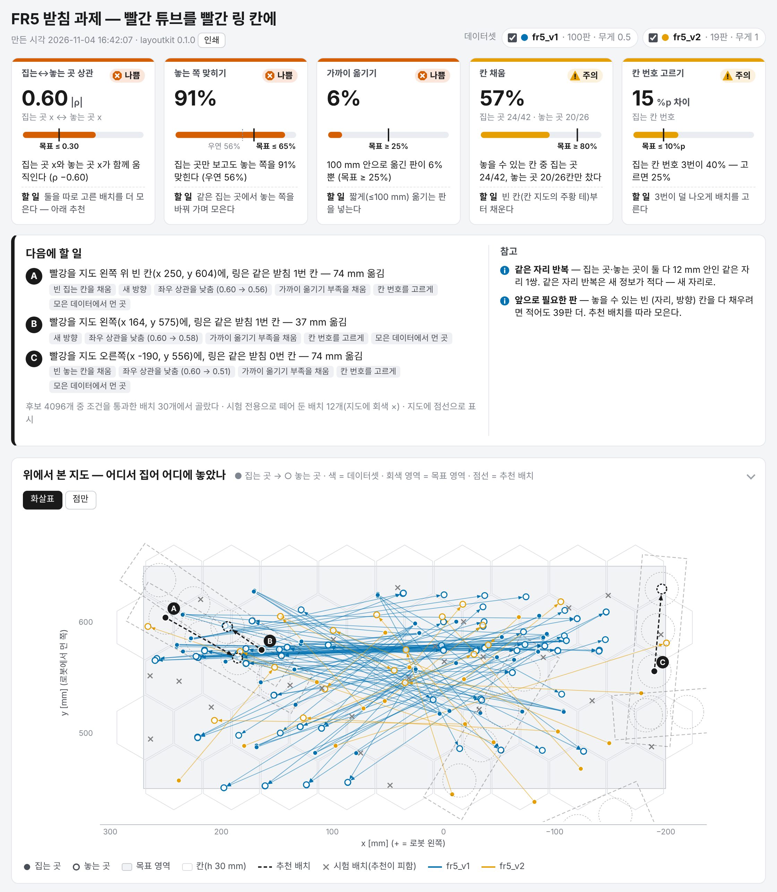
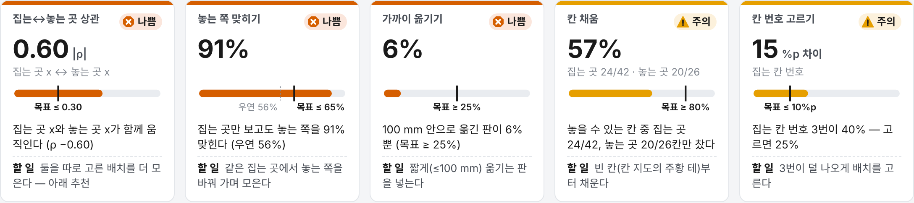
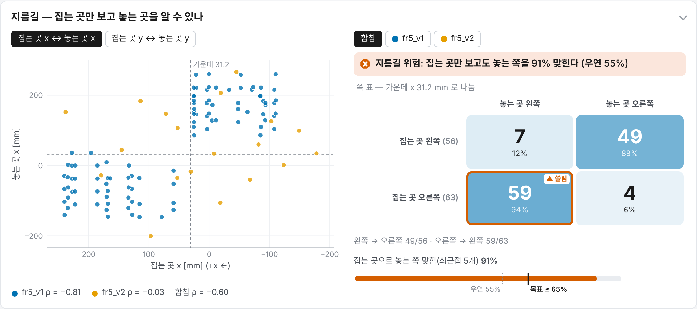
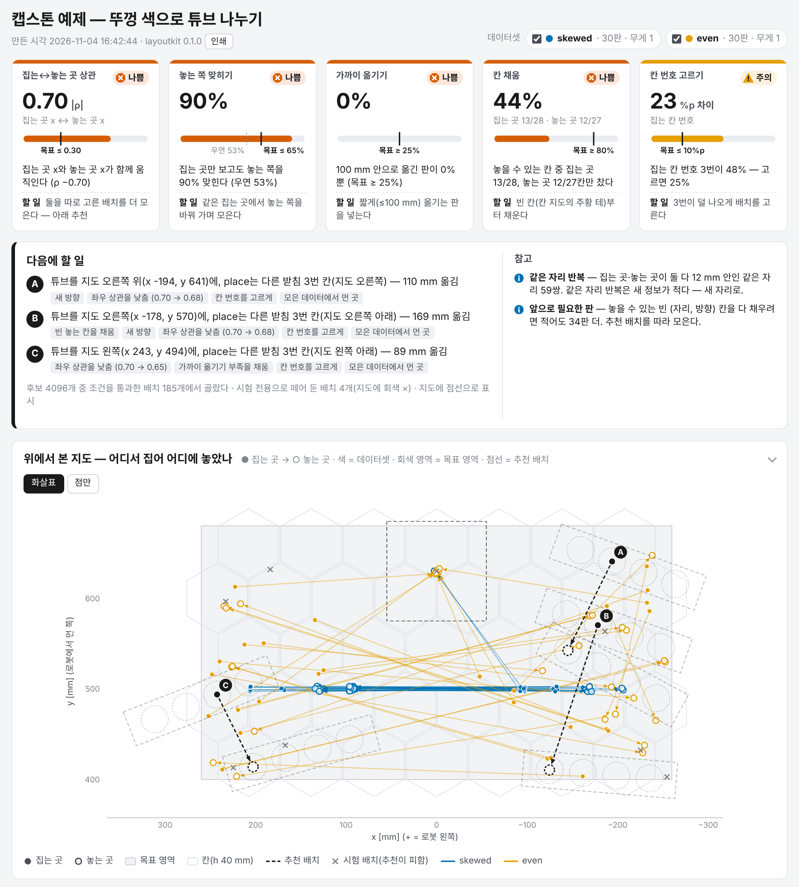
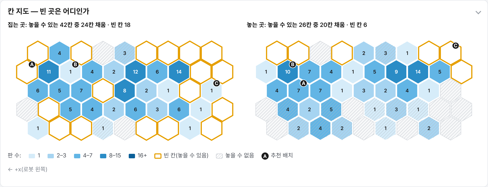
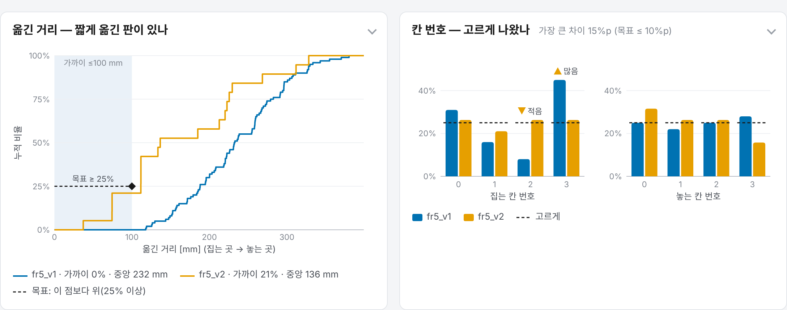
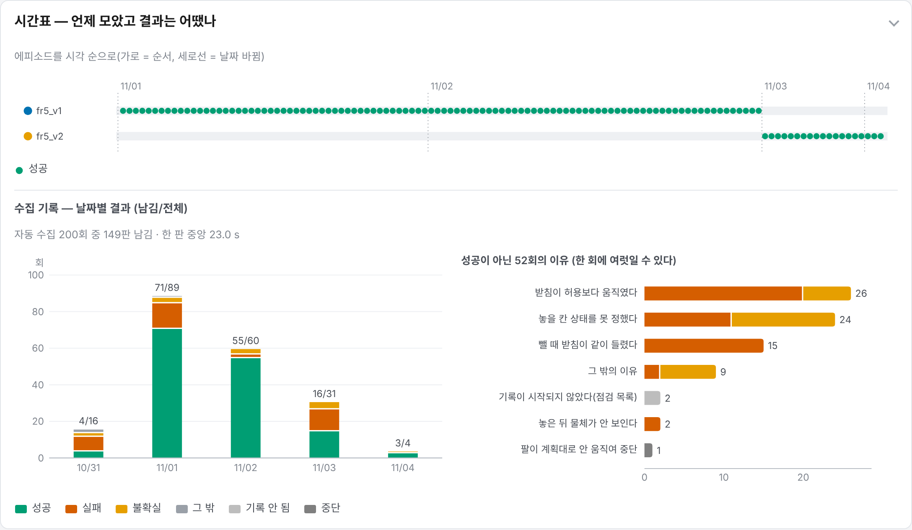

# layoutkit

로봇 조작 시연 데이터셋의 배치(물체를 어디서 집어 어디에 놓았나)를 분석해 빈 곳과 지름길을 찾고, 다음에 모을 배치를 추천하고, 결과를 외부 요청 없는 HTML 한 장으로 보여 주는 파이썬 패키지.
numpy 만 있으면 로봇·카메라·서버 없이 어디서든 돈다.



*받침 과제 예제(FR5 실물 v1 100판 + v2 19판)의 화면 윗부분. 신호등 카드, 다음에 모을 배치 A·B·C, 위에서 본 지도(● 집는 곳 → ○ 놓는 곳, 점선 = 추천).*

---

## 한눈에

| 항목 | 내용 |
|---|---|
| 입력 | 시연 데이터셋(fr5rec · LeRobot v2.x · CSV/JSON 표 …)과 과제 선언 `spec.json`(영역 · 칸 크기 · 고정물 · 검사 · 카메라) |
| 분석 | 집는·놓는 자리 상관, 집는 자리만으로 놓는 쪽 맞히기, 옮긴 거리, 칸 채움, 이산 칸 치우침, 같은 자리 반복, 앞으로 필요한 판 수 |
| 추천 | 놓을 수 있는 배치 중에서 빈 칸을 채우고 상관을 줄이는 다음 배치 A·B·C 와 이유 |
| 화면 | HTML 파일 한 장(인라인 SVG · CSS · JS). 인터넷 없는 로봇 PC 에서도 열린다. 한국어 · 영어 |
| 의존 | numpy. 선택: pyarrow(LeRobot parquet) · PyYAML(YAML spec) · matplotlib(PNG) |
| 출발점 | FR5 받침 과제의 배치 추천기(FR5-AutoCollect `fr5auto/rackrec.py`). 수학이 같다 — 같은 후보 16384개에서 통과 121개가 번호까지 같다 |

## 왜 만들었나

FAIRINO FR5 로 모은 받침 과제 첫 데이터셋(v1, 100판)은 받침 배치를 몇 가지로 정해 두고 모았다. 빨강 튜브를 왼쪽에서 집으면 링은 거의 항상 오른쪽이었고(44/44, 반대는 52/56), 집는 x 와 놓는 x 의 상관이 −0.81 이었다. 100 mm 이하로 옮긴 판은 없었다.
이 데이터로 학습한 정책은 학습 때와 다른 받침 위치 30회 시험에서 30회 모두 실패했다([FR5-AutoCollect](https://github.com/justwooju/FR5-AutoCollect)).

화면 속 링을 보지 않아도 "집은 자리의 반대편으로 약 230 mm"만 배우면 학습 손실이 낮아지는 데이터였다. 모방 학습은 이런 쉬운 단서를 먼저 배운다(인과 혼동 · 지름길 학습, [ANALYSIS.md 2절](docs/ANALYSIS.md#2-지름길)).
모으기 전에, 모으는 동안 이것을 숫자로 보고 다음 배치를 고르는 도구가 필요했다. 받침 과제용으로 만든 것을 다른 과제·데이터 형식에도 쓰게 떼어 냈다.

## 무엇을 알려 주나

VLA 미세조정·모방 학습 데이터에서는 판 수만큼 배치가 얼마나 다양한지, 지름길이 없는지가 중요하다. 이를 신호등 카드 일곱 개로 잰다.
다섯 개는 좋음 · 주의 · 나쁨을 내고, 둘은 정보다. 문턱은 spec 의 `targets` 로 바꾼다.

| 카드 | 재는 것 | 왜 보나 |
|---|---|---|
| 집는↔놓는 곳 상관 | 집는 자리와 놓는 자리 좌표의 가중 상관 \|ρ\|(x↔x, y↔y 중 큰 것). 좋음 ≤ 0.3 | 상관이 크면 정책이 놓을 곳 표시를 보지 않고 집은 자리(팔 자세)만으로 목표를 맞힐 수 있다. 시험 배치가 바뀌면 틀린다 |
| 놓는 쪽 맞히기 | 집는 자리 xy 만으로 놓는 쪽(왼/오)을 맞히는 최근접 이웃(5개) 정확도, 우연과 함께. 좋음 ≤ 65 % | 상관은 직선 관계만 본다. 집는 자리가 몇 곳에 몰려 있으면 직선이 아닌 지름길도 생긴다 |
| 가까이 옮기기 | 100 mm 이하로 옮긴 판 비율. 좋음 ≥ 25 % | 짧은 이동을 본 적 없는 정책에게 가까운 목표는 학습 분포 밖이다 |
| 칸 채움 | 육각 칸(h 30 mm) 중 판이 든 칸 / 놓을 수 있는 칸. 좋음 ≥ 80 % | 정책은 본 자리 근처에서만 믿을 만하다. 일반화는 시연 수보다 배치·환경 수에 크게 좌우된다 |
| 칸 번호 고르기 | 이산 칸(받침 칸 번호, 색 …) 비율이 목표에서 벗어난 최대값. 좋음 ≤ 10 %p | 끝 칸에만 몰리면 칸 번호가 또 하나의 단서가 된다 |
| 같은 자리 반복 | 집는·놓는 자리가 모두 12 mm 안인 판 짝 | 같은 배치를 여러 번 모으면 판 수만 늘고 배치 수는 안 는다 |
| 앞으로 필요한 판 | 놓을 수 있는 빈 칸을 다 채우는 데 드는 판 수의 하한(무작위면 n·H_n) | 수집 계획. 골라 채우면 무작위보다 몇 배 적게 든다 |

정의와 식은 [ANALYSIS.md](docs/ANALYSIS.md), 추천이 이 숫자를 어떻게 쓰는지는 [RECOMMEND.md](docs/RECOMMEND.md).



*받침 예제의 카드. 상관 · 맞히기 · 가까이가 나쁨, 칸 채움 · 칸 번호가 주의다.*

## 빠른 시작

필요한 것: Python 3.9 이상, numpy.

```bash
# 저장소 폴더에서
pip install -e .                 # 또는 pip install .   (선택 의존까지: pip install -e ".[all]")

python -m layoutkit demo         # demo/report.html · result.json · episodes.csv
```

`demo` 는 `examples/rack_fr5` 의 실물 데이터로 분석 · 추천 · 화면을 만든다(이 환경에서 약 3 s). `demo/report.html` 을 브라우저로 연다.
설치하지 않고 저장소 폴더에서 `python3 -m layoutkit …` 로 돌려도 된다. `pip install .`(복사 설치)로 설치한 `layoutkit demo` 는 예제 폴더를 못 찾으므로 `--examples examples` 를 준다.

자기 데이터:

```bash
# 분석만 — spec 이 없으면 영역은 데이터 범위로 짐작한다
layoutkit analyze ~/fr5cap/datasets/my_task --out report.html

# spec 짐작 → 고친 뒤 분석 + 추천
layoutkit init-spec ~/fr5cap/datasets/my_task --out spec.json
layoutkit recommend old=~/data/old.json new=~/fr5cap/datasets/my_task --weight old=0.5 --spec spec.json --out report.html

# 모으는 동안 폴더를 지켜보며 화면을 다시 만든다
layoutkit watch ~/fr5cap/datasets/my_task --spec spec.json --out report.html --recommend --every 5
```

명령과 옵션 전부는 [AUTOMATION.md](docs/AUTOMATION.md), spec 키 전부는 [SPEC.md](docs/SPEC.md).

파이썬:

```python
import layoutkit as lk
v1 = lk.load_dataset("examples/rack_fr5/data/v1_tags.json", name="fr5_v1", weight=0.5)
v2 = lk.load_dataset("examples/rack_fr5/data/v2_layouts_20261103.json", name="fr5_v2")
res = lk.analyze([v1, v2], "examples/rack_fr5/spec.json")
lk.recommend([v1, v2], "examples/rack_fr5/spec.json", result=res, n=3, seed=1)
lk.render(res, "report.html")
```

## 지원 데이터 형식

| 형식 | 경로 | 자리를 얻는 법 | 비고 |
|---|---|---|---|
| fr5rec 원본 | `ep_*/meta.json` 이 든 폴더 | 꼬리표(`red_xy` · `slot_xy` · 받침 · 칸)가 있으면 그것, 없으면 궤적(`tcp_base_mm_deg` · `grip_width`) 사건 | 기록 중(`.part`) · 버린 판(`_discarded/`)은 안 읽음. 첫 3인칭 사진을 썸네일로 |
| 받침 꼬리표 JSON | `{"episodes": [{"ep", "meta"}]}` · 특징 묶음 `{"R", "S", ...}` | 꼬리표 | 받침 v1 예제 |
| LeRobot v2.x | `meta/info.json` 이 든 폴더 | 상태·EEF 열의 궤적 사건(그리퍼 닫힘 = 집음, 열림 = 놓음) | pyarrow 필요. 열 이름 짐작 · 옵션으로 지정. 관절각뿐인 상태는 못 읽음 |
| CSV / JSON / JSONL 표 | 한 줄 = 에피소드 | 열(`pick_x` · `place_xy` · `red_xy` … 짐작, 또는 `--map`) | `--opt scale=1000` 으로 m → mm |
| layoutkit 에피소드 JSON | `start`·`goal` 이 `{"x", "y"}` 인 목록 | 그대로 | 캡스톤 예제 |
| fr5auto 실행 기록 | `runs.jsonl` · `runs_*.csv` | — | 데이터셋이 아니라 수집 기록(날짜별 결과 · 실패 이유 · 시간) |

형식은 자동으로 판별한다. 읽는 규칙·옵션·사건 찾기는 [ADAPTERS.md](docs/ADAPTERS.md).

## 예제

### 받침 과제 — FR5 실물

[examples/rack_fr5](examples/rack_fr5/spec.json). 받침 둘(4칸), 빨강·노랑 튜브, 빨간 링이 끼워진 빈 칸. 빨강을 집어 링 칸에 꽂는다. spec 에 실물 3인칭 카메라 보정과 손목 창이 들어 있다.

| 지표 | v1 (배치 고정, 100판) | v2 (fr5auto 배치 추천, 19판) |
|---|---|---|
| ρ(집는 x, 놓는 x) | −0.81 | −0.03 |
| 집는 쪽으로 놓는 쪽 맞힘: 쪽 표 · 최근접 이웃 | 96 % · 100 % | 63 % · 58 % (우연 63 %) |
| 100 mm 이하로 옮김 | 0 % | 21 % |
| 옮긴 거리 중앙 | 232 mm | 136.5 mm |
| 서로 다른 자리 집는 · 놓는 · 짝 (12 mm 묶음) | 32 · 43 · 99 | 19 · 19 · 19 |
| 같은 받침 안에서 옮김 | 0 | 8 |



*v1(파랑)은 집는 x 가 기준선 왼쪽이면 놓는 x 가 오른쪽, 오른쪽이면 왼쪽 — 두 덩어리다. v2(주황)는 네 칸에 흩어진다. 오른쪽 쪽 표는 합친 데이터(v1 무게 0.5).*

v1 무게 0.5 + v2 로 추천을 돌리면(시드 1) 후보 4096개 중 검사(로봇 닿음 · 3인칭 시야 · 받침 사이 틈 · 시선 각 · 링 보임)를 통과한 30개에서 A·B·C 를 고른다. 세 선택지 모두 같은 받침 안에서 짧게 옮기는 배치이고 상관을 0.60 에서 0.51~0.58 로 낮춘다([RECOMMEND.md 13절](docs/RECOMMEND.md#13-예제-결과)).

### 캡스톤 색 분류 — 가짜 데이터

[examples/capstone_colorsort](examples/capstone_colorsort/README.md). 뚜껑 색으로 튜브를 나눈다(빨강 → 빨강 받침, 초록 → 초록 받침, 검정 → 버림 통). 규칙(`layout.rule`), 고정된 버림 통, 금지 구역, python 훅(옮기는 길이 다른 받침 위를 지나지 않게)을 쓰는 예다. 데이터는 `make_synth.py` 가 만든 가짜다.

```bash
python3 examples/capstone_colorsort/make_synth.py
layoutkit recommend skewed=examples/capstone_colorsort/data/skewed.json even=examples/capstone_colorsort/data/even.json \
    --spec examples/capstone_colorsort/spec.json --out capstone.html
```

| 데이터 | \|ρ(x)\| | 놓는 쪽 맞힘 | 채운 (자리, 방향) 칸 집는 · 놓는 | N_min |
|---|---|---|---|---|
| skewed 30판(받침 자리 고정, 빨강 70 %, 끝 칸만) | 0.97 | 93 % | 3 · 3 (놓을 수 있는 52 · 48) | 49 |
| skewed + even 60판(even = 놓을 수 있는 배치 중 무작위) | 0.70 | 90 % | 20 · 14 | 34 |



*skewed(파랑)는 받침 둘이 늘 같은 자리라 화살표가 y 500 근처 한 줄에 몰린다. 점선 윤곽은 추천 A·B·C 의 받침 자리, 가운데 위 점선 사각형은 고정된 버림 통.*

## 화면 구성

위에서부터 신호등 카드 → 다음에 할 일 → 위에서 본 지도 → 칸 지도 → 지름길 → 옮긴 거리 · 칸 번호 → 데이터셋 비교 → 시간표 · 수집 기록 → 에피소드 표다. 패널마다 읽는 법은 [DASHBOARD.md](docs/DASHBOARD.md).



*칸 지도. 숫자 = 판 수, 주황 테 = 놓을 수 있는데 빈 칸, 빗금 = 놓을 수 없는 칸(추천의 검사로 셈), 검은 딱지 = 추천이 쓰는 칸.*



*옮긴 거리 누적 분포(v1 은 120 mm 앞까지 0)와 집는·놓는 칸 번호 비율. 점선 = 목표.*



*에피소드 순서와 자동 수집 실행 200회의 날짜별 결과 · 실패 이유(fr5auto 실행 기록).*

데이터셋 켜기/끄기, 점 위 말풍선, 표의 줄을 누르면 지도에서 강조, 표 정렬·거르기, ko/en, 인쇄, PNG 내보내기(`--png`)가 된다.

## 저장소 구조

```
layoutkit/
├── layoutkit/            파이썬 패키지(numpy 만 필수)
│   ├── adapters/         형식별 읽기: fr5rec · lerobot · table · fr5auto_runs
│   ├── analyze/          지표: coverage · coupling · distribution · compare · runs · verdict
│   ├── recommend/        추천: layout · sample · constraints · camera · score · select
│   ├── report/           화면: html · svg · i18n · figures(PNG)
│   ├── automate/         watch · pipeline
│   ├── events.py         궤적 → 집음·놓음 사건
│   ├── spec.py · data.py · cli.py
├── examples/
│   ├── rack_fr5/         FR5 받침 과제 spec + 실물 데이터(v1 꼬리표 · v2 배치 · 실행 기록 · 3인칭 보정)
│   ├── capstone_colorsort/  색 분류 spec · 가짜 데이터 생성 · python 훅
│   └── lerobot_demo/     작은 LeRobot v2.1 데이터셋 생성
├── tests/                시험 5개 + 화면 시험용 결과(fixtures/)
├── docs/                 문서
├── fig/                  README · 문서 그림
├── CHANGELOG.md
└── pyproject.toml
```

## 문서

| 문서 | 내용 |
|---|---|
| [SPEC.md](docs/SPEC.md) | spec 키 전부: 기본값 · 뜻 · 받침 · 캡스톤 · points 예 |
| [ANALYSIS.md](docs/ANALYSIS.md) | 지표마다 정의 · 식 · 문턱 · 해석, 받침 v1 · v2 숫자 |
| [RECOMMEND.md](docs/RECOMMEND.md) | 후보 · 검사 · 점수 · 고르기 · 선택지 A/B/C · 시험 배치 · 큐 · 이유 코드 · fr5auto 와 일치 |
| [DASHBOARD.md](docs/DASHBOARD.md) | 화면 패널마다 읽는 법, 상호작용, ko/en, 인쇄 · PNG |
| [ADAPTERS.md](docs/ADAPTERS.md) | 형식별 읽는 법 · 옵션 · 궤적 사건 찾기 · 한계 |
| [AUTOMATION.md](docs/AUTOMATION.md) | 명령 전부와 옵션, watch, pipeline 설정, 파이썬 API |
| [TESTING.md](docs/TESTING.md) | 시험 파일 · 돌리는 법 · 확인하는 숫자 |
| [ARCHITECTURE.md](docs/ARCHITECTURE.md) | 모듈 구조, 결과 dict 모양, 데이터 흐름 |
| [CHANGELOG.md](CHANGELOG.md) | 버전별 변경 |

## 한계

- 사건 추출은 에피소드 하나에서 집기 · 놓기를 한 번만 찾는다. 여러 물체를 차례로 옮기는 에피소드는 나눠서 넣어야 한다. 자리는 그리퍼를 닫고 열 때의 손 자리다.
- 이 개발 환경에는 pyarrow 가 없어 LeRobot parquet 파일을 실제로 읽는 경로는 시험하지 못했다. 같은 열을 메모리에서 넘기는 시험과 가짜 데이터로만 확인했다.
- 방향 칸 정의가 분석과 추천에서 다르다. 분석은 에피소드 yaw(받침 예제는 잡는 손목 각), 추천은 고정물 줄 방향(yaw + `episode_yaw_offset_deg`)으로 센다. 그래서 '앞으로 필요한 판'이 명령 출력(자리 칸 기준)과 화면(추천의 (자리, 방향) 칸 기준)에서 다르게 나온다.
- 추천에 계획(역기구학) 검사가 없다. 로봇이 그 배치를 실제로 집고 놓을 수 있는지는 spec 의 python 훅(`stage: "final"`)으로 넣는 자리만 있다.
- 시간표의 가로축은 시각이 아니라 순서다. 날짜가 바뀌는 곳만 선으로 표시한다.
- 놓을 수 있는 칸은 고정 시드 후보 16384개로 센 표본이다. 카메라 보정이 없으면 시야 · 가림 검사는 건너뛴다(화면에 '검사 못 한 조건'으로 보인다).
- 캡스톤 예제의 치수·자리는 예제 값이고 데이터는 가짜다.

## 관련 저장소

| 저장소 | 관계 |
|---|---|
| [FR5-AutoCollect](https://github.com/justwooju/FR5-AutoCollect) | FR5 받침 과제 자동 수집기와 원래 배치 추천기(`fr5auto/rackrec.py`). layoutkit 의 수학과 받침 예제 데이터의 출처 |
| [FR5-GR00T-Benchmark](https://github.com/SungjinDavidLee/FR5-GR00T-Benchmark) | FR5 정책 평가(롤아웃과 결과 분석) |

## 공개본에서 가린 것

예제 데이터와 문서의 경로는 `~/fr5cap/...` 처럼 집 폴더를 `~` 로 바꿨다. 분석 결과·화면에 남는 경로도 같은 방식으로 가린다. 3인칭 카메라 보정 값(내부 행렬 · 왜곡 · 카메라 자세)은 추천 검사에 필요해 그대로 두었다.

## 라이선스

MIT — [LICENSE](LICENSE).
