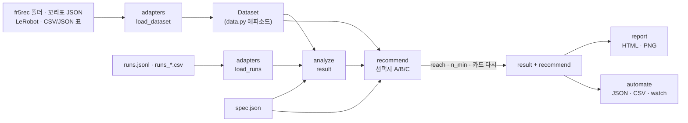

# layoutkit 구조

로봇 조작 시연 데이터셋의 배치(물체를 어디서 집어 어디에 놓았나)를 읽고, 분석하고, 다음 배치를 추천하고, HTML 한 장으로 그리는 흐름과 모듈 경계를 적는다.
코드 주석의 `docs/ARCHITECTURE.md N절`은 이 문서의 절 번호다.

## 목차

1. [원칙](#1-원칙)
2. [폴더](#2-폴더)
3. [분석 결과(result) 모양](#3-분석-결과result-모양)
4. [spec.layout](#4-speclayout)
5. [화면 순서](#5-화면-순서)
6. [명령](#6-명령)
7. [받아들이는 기준](#7-받아들이는-기준)
8. [데이터 흐름](#8-데이터-흐름)

## 1. 원칙

- 의존: numpy 만 필수다. 선택 의존은 PyYAML(YAML spec·설정), pyarrow(LeRobot parquet), matplotlib(PNG 그림), Pillow 다.
- 화면: HTML 파일 한 장이다. 외부 요청이 없다(CDN·글꼴 링크 없음). 인라인 SVG + 인라인 CSS + 바닐라 JS 라 인터넷 없는 로봇 PC 에서도 열린다.
- 색: Okabe–Ito 순서를 고정한다. 데이터셋은 파랑 #0072B2 → 주황 #E69F00 → 초록 #009E73 → 보라 #CC79A7 → 하늘 #56B4E9 → 주홍 #D55E00 순이다.
  상태 색은 좋음 #009E73 · 주의 #E69F00 · 나쁨 #D55E00 · 정보 #0072B2 이고, 색만으로 뜻을 전하지 않는다(글자·모양을 같이 쓴다).
- 말: 화면 글은 한국어가 기본이고 `lang: en` 이면 영어다. 사전은 `layoutkit/report/i18n.py` 하나다. 분석 결과에는 코드와 숫자만 담고, 사람이 읽는 글은 화면이 만든다.
- 경로: 결과와 화면에 남는 경로는 지금 폴더 기준 상대 경로이거나 집 폴더를 `~` 로 바꾼 것이다(`adapters.display_path`). 계정 이름이 결과 파일에 들어가지 않는다.
- 수학: FR5-AutoCollect 의 받침 과제 배치 추천기(`fr5auto/rackrec.py`)에서 가우스 과정 분산·Halton 후보·육각 칸·k-center·가중 상관·쿠폰 수집·softmax 고르기를 그대로 가져왔다.
  받침에 묶인 부분(배치 변수·놓을 수 있는 영역 검사·꼬리표 읽기)은 spec 선언과 어댑터로 바꿨다.

## 2. 폴더

```
layoutkit/
  __init__.py          버전, 공개 함수(load_dataset, load_runs, analyze, recommend, render, export_png, load_spec)
  __main__.py          python -m layoutkit
  cli.py               명령: analyze · recommend · compare · watch · report · init-spec · demo · pipeline
  data.py              에피소드·데이터셋 모양(모든 어댑터의 출력)
  spec.py              과제 선언 읽기·기본값(DEFAULTS)·검사
  events.py            궤적 → 사건(그리퍼 닫힘 = 집음, 열림 = 놓음) → 집은 자리·놓은 자리
  adapters/
    __init__.py        load_dataset(path, kind="auto", **opt) — 형식 자동 판별
    fr5rec.py          fr5rec 폴더(ep_*/meta.json) · 받침 꼬리표 JSON · 특징 묶음(feat.json)
    lerobot.py         LeRobot v2.x(meta/info.json, data/chunk-*/episode_*.parquet) — pyarrow 필요
    table.py           CSV · JSON · JSONL 표(에피소드 한 줄), layoutkit 에피소드 JSON
    fr5auto_runs.py    fr5auto 실행 기록(runs.jsonl · runs_*.csv) → Runs
  analyze/
    __init__.py        analyze(datasets, spec, runs) → result
    coverage.py        육각 칸, 방향 칸, 채움, N_min, 쿠폰 수집, 채움 거리
    coupling.py        가중 상관, 쪽 표, 최근접 이웃 맞힘
    distribution.py    범위, 서로 다른 자리(12 mm 묶음), 옮긴 거리, 이산 칸, 같은 자리 짝
    compare.py         데이터셋마다 같은 지표 나란히
    runs.py            실행 기록 요약(날짜별 결과·이유·시간)
    verdict.py         신호등 카드(code·args 만)
  recommend/
    __init__.py        recommend(datasets, spec, result=None, n=3, ...) · reach(spec)
    layout.py          spec.layout 해석(points · fixtures)
    sample.py          Halton + Cranley–Patterson 후보 뽑기
    constraints.py     검사(area · reach · gap · keepout · yaw_window · in_view · view_angle · goal_visible · hook)
    camera.py          핀홀 + 브라운 왜곡 투영
    score.py           가우스 과정 분산 · 상관 항 · 이산 칸 항 · 수고 · 칸
    select.py          고르기 · 선택지 A/B/C · 시험 배치(k-center) · 큐
  report/
    __init__.py        render(result, out_html, lang) · export_png(result, out_dir)
    html.py            한 장 HTML 조립(카드·패널·표·JS)
    svg.py             SVG 그리기 도구
    i18n.py            ko/en 사전
    figures.py         PNG 내보내기(matplotlib)
  automate/
    watch.py           폴더 지문 감시 → 다시 만들기
    pipeline.py        build(한 번 돌리기) · run_config(설정 파일) · CSV 내보내기
examples/
  rack_fr5/            받침 과제 spec(실물 3인칭 카메라 포함) · data/(v1 꼬리표 100판, v2 19판, 실행 기록 200회)
  capstone_colorsort/  뚜껑 색 → 정해진 받침·버림 통 spec · 가짜 데이터 생성 · python 훅
  lerobot_demo/        작은 LeRobot v2.1 데이터셋 생성(참값 포함)
tests/                 test_rack_numbers · test_adapters · test_recommend · test_report · test_cli · fixtures/
docs/                  이 문서 외 SPEC · ANALYSIS · RECOMMEND · DASHBOARD · ADAPTERS · AUTOMATION · TESTING
fig/                   README·문서 그림
```

`layoutkit.recommend` 와 `layoutkit.report` 는 따로 된 하위 패키지다. 둘 중 하나가 없거나 깨져도 `analyze()` 는 돈다. 이때 `recommend()`·`render()` 는 무엇이 없는지 `ImportError` 로 알린다.

## 3. 분석 결과(result) 모양

`analyze()` 가 내는 dict 다. `--json` 으로 그대로 저장되고, 화면·추천·자동화는 이 dict 만 읽는다. 아래 값은 받침 예제(`layoutkit demo`)의 것이다.

```json
{
  "tool": "layoutkit", "version": "0.1.0", "created": "2026-11-04T16:42:07",
  "spec": { "... spec.load() 결과(기본값 채운 것, 카메라 포함)": "" },
  "datasets": [{"name": "fr5_v1", "n": 100, "n_usable": 100, "n_success": 100, "n_used": 100, "weight": 0.5,
                "color": "#0072B2", "kind": "fr5rec", "path": "examples/rack_fr5/data/v1_tags.json", "note": "...",
                "meta": {"form": "tags", "how": {"tag": 100}}}],
  "episodes": [{"id": "fr5_v1/ep_000", "dataset": "fr5_v1", "t": "2026-11-01T17:48:01", "outcome": "success", "weight": 0.5,
                "start": {"x": 240.3, "y": 579.8, "yaw": 77.2}, "goal": {"x": -29.28, "y": 573.71, "yaw": 77.2},
                "discrete": {"start_fixture": 1, "start_slot": 3, "goal_fixture": 0, "goal_slot": 3, "same_fixture": false,
                             "obstacle_slot": 0, "arrangement": "Y○○R"},
                "cell_start": 36, "cell_goal": 31, "move_mm": 269.6, "flags": []}],
  "unusable": [],
  "area": {"x": [-200.0, 270.0], "y": [450.0, 650.0]},
  "cards": [{"id": "coupling", "status": "bad", "value": 0.604, "unit": "|ρ|", "target": "≤ 0.3",
             "code": "coupling_high", "args": {"pair": "start.x→goal.x", "rho": -0.604}}],
  "coverage": {"h": 30.0, "centers": [[-172.8, 460.0]], "n_cells": 47, "n_hex": 41, "yaw_bins": 3, "n_theory": 123,
               "start": {"count": [], "n": [], "count_by_ds": {"fr5_v1": []}, "reach": [], "outside": 0},
               "goal": {},
               "filled_start": 26, "filled_goal": 31, "reach_start": 42, "reach_goal": 26,
               "n_min": 18, "n_min_yaw": 108, "n_min_basis": "reach", "coupon_random": 663.4,
               "fill_dist_mm": {"start": 60.8, "goal": 59.4}, "hull_m2": 0.0725},
  "coupling": {"pairs": [{"a": "start.x", "b": "goal.x", "rho": -0.604, "rho_by_ds": {"fr5_v1": -0.807, "fr5_v2": -0.034}}],
               "side": {"split": 31.2, "axis": "x", "table": [[49, 7], [4, 59]], "rows": ["left", "right"],
                        "cols": ["right", "left"], "left_is": "hi", "acc": 0.908, "acc_w": 0.855, "n_cross": 108, "n": 119},
               "predict": {"knn_acc": 0.908, "chance": 0.555, "k": 5, "n": 119}},
  "transfer": {"values": [], "min": 37.2, "median": 225.9, "max": 380.2, "near_share": 0.058, "near_n": 4, "near_mm": 100.0},
  "spots": {"start": 49, "goal": 56, "pairs": 118, "dup_mm": 12.0, "n_dups": 1, "dup_episodes": 1,
            "dups": [["fr5_v1/ep_044", "fr5_v1/ep_050", 7.9]]},
  "strata": [{"name": "start_slot", "rows": [{"value": 0, "n": 36, "w": 20.5, "share": 0.297, "target": 0.25}],
              "max_dev": 0.149, "n_known": 119, "n_other": 0}],
  "discrete": {"arrangement": {"Y○○R": 46}},
  "ranges": {"start.x": [-178.0, 240.3]},
  "timeline": [{"t": "2026-11-01T17:48:01", "id": "fr5_v1/ep_000", "dataset": "fr5_v1", "outcome": "success", "flags": []}],
  "runs": {"n": 200, "by_verdict": {"success": 148}, "by_day": [], "reasons": [], "durations": {}},
  "recommend": {"options": [], "holdout": [], "skipped_checks": [], "n_cand": 4096, "n_feasible": 30, "cells": {}},
  "compare": {"datasets": ["fr5_v1", "fr5_v2"], "metrics": [{"key": "rho:start.x→goal.x",
              "values": {"fr5_v1": -0.807, "fr5_v2": -0.034}, "diff": 0.773, "better": null}]},
  "notes": []
}
```

- 쓴 에피소드: 집은 자리·놓은 자리가 둘 다 있고 `outcome` 이 `success` 또는 없음(`None`)인 판이다(`--all-outcomes` 면 전부). 자리는 있는데 결과로 뺀 판은 `episodes` 에 `excluded` 깃발로 남고, 자리가 없는 판은 `unusable` 에만 남는다.
- `recommend` 는 추천을 같이 돌렸을 때만 채워진다. 그때 `coverage.*.reach`·`reach_*`·`n_min`·카드가 놓을 수 있는 칸 기준으로 다시 계산된다(`analyze.coverage.apply_reach`).
- `runs` 는 실행 기록을 줬을 때만, `compare` 는 데이터셋이 둘 이상일 때만 채워진다.
- 키마다 뜻과 식은 [ANALYSIS.md](ANALYSIS.md), 추천 선택지 모양은 [RECOMMEND.md](RECOMMEND.md#9-선택지-모양)에 있다.

신호등 카드(`cards`)는 `analyze/verdict.py` 가 만든다. 문턱은 `spec.targets` 다.

| id | 값 | 좋음 | 주의 | 나쁨 |
|---|---|---|---|---|
| coupling | 가장 큰 \|ρ\|(spec.pairs, 합친 데이터, 가중) | ≤ rho_max | ≤ rho_bad | 그 위 |
| predict | 출발만으로 목표 쪽 맞힘(최근접 이웃) | ≤ predict_good | ≤ predict_bad | 그 위 |
| near | 가까이 옮긴 비율(가중) | ≥ near_share | ≥ near_warn | 그 아래 |
| coverage | 채운 칸 / 놓을 수 있는 칸(모르면 / 전체 칸), 집는·놓는 쪽 중 낮은 것 | ≥ coverage_good | ≥ coverage_warn | 그 아래 |
| strata | 이산 칸 비율이 목표에서 벗어난 최대값 | ≤ strata_dev_good | ≤ strata_dev_bad | 그 위 |
| dups | 같은 자리 짝이 있는 판 비율 | 정보 | | |
| n_min | 앞으로 필요한 판 수의 하한 | 정보 | | |

카드에는 `code`(이유 종류)와 `args` 만 있다. 화면이 `i18n.CARD[code]` 틀에 `args` 를 넣어 "왜"와 "할 일" 한 줄씩 만든다.

## 4. spec.layout

추천이 고르는 배치 변수의 모양이다. 두 가지가 있다.

```json
"layout": {"kind": "points", "min_move_mm": 30}
```

`points` 는 집는 자리·놓는 자리를 목표 영역 안에서 직접 고른다.

```json
"layout": {
  "kind": "fixtures",
  "fixtures": [{"name": "rack", "count": 2, "size_mm": [170, 40], "slots": 4, "pitch_mm": 37.18, "slot_axis": "length"}],
  "items": [{"name": "red", "role": "start"}, {"name": "yellow", "role": "obstacle"}, {"name": "ring", "role": "goal"}],
  "same_fixture_allowed": true,
  "yaw_window": {"center_deg": -82.0, "half_deg": 54.0}
}
```

`fixtures` 는 받침 같은 고정물을 놓고 물건을 고정물의 칸에 둔다. start = (고정물 a 의 칸 ks), goal = (고정물 b 의 칸 kg) 로 받침 과제와 같다.
키 전부는 [SPEC.md 4절](SPEC.md#4-layout--추천이-고르는-배치), 검사(`constraints`)는 [SPEC.md 5절](SPEC.md#5-constraints--놓을-수-있는-배치-검사)에 있다.

## 5. 화면 순서

위에서부터 머리줄 → 신호등 카드 → 다음에 할 일 → 위에서 본 지도 → 칸 지도 → 지름길 → 옮긴 거리 · 칸 번호 → 데이터셋 비교 → 시간표(+ 수집 기록) → 에피소드 표다.
모든 그림은 같은 x 방향(`spec.frame.x_left_positive`)과 같은 데이터셋 색을 쓴다. 패널마다 읽는 법은 [DASHBOARD.md](DASHBOARD.md)에 있다.

## 6. 명령

```
layoutkit analyze   DATA... [--spec S] [--weight NAME=W] [--runs R] [--out report.html] [--json result.json] [--png DIR] [--lang en]
layoutkit recommend DATA... --spec S [--n 3] [--seed N] [--out report.html] [--json result.json]
layoutkit compare   A B ... [--spec S] [--out compare.html]
layoutkit watch     DIR... --spec S (--out report.html | --json result.json) [--every 5] [--recommend] [--once] ...
layoutkit report    result.json --out report.html [--lang en]
layoutkit init-spec DATA... --out spec.json
layoutkit demo      [--out demo] [--examples DIR]
layoutkit pipeline  config.json
```

DATA 는 폴더(fr5rec·LeRobot 자동 판별) · .csv · .json · .jsonl 이다. `이름=경로` 로 이름을 붙인다. 옵션 전부는 [AUTOMATION.md](AUTOMATION.md)에 있다.

## 7. 받아들이는 기준

시험이 다시 확인하는 숫자다. 돌리는 법과 파일별 내용은 [TESTING.md](TESTING.md)에 있다.

- 받침 v1(`examples/rack_fr5/data/v1_tags.json`, FR5-AutoCollect `tests/data/v1_tags.json` 과 같은 판): 왼쪽(x > 64.9) → 오른쪽 44/44, 오른쪽 → 왼쪽 52/56,
  ρ(start.x, goal.x) −0.81, ρ(start.y, goal.y) −0.43, 옮긴 거리 118~380 mm · 중앙 232 · 100 mm 이하 0판, 서로 다른 자리 32 · 43 · 99,
  빨강 칸 31/16/8/45, 링 칸 25/22/25/28, 채운 칸(h 30 mm, 영역 x −200~270 · y 450~650, 47칸) 20 · 27, 이론 칸 41 × 3 = 123, 무작위 기댓값 663.
- 받침 v2(`v2_layouts_20261103.json`): ρ(x) −0.03, 가까이 21 %, 자리 19 · 19 · 19, 같은 받침 8.
- 어댑터: 가짜 LeRobot 궤적·가짜 fr5rec 궤적에서 사건으로 찾은 자리 오차 ≤ 2 mm.
- 추천: 받침 spec(실물 3인칭 카메라)에서 후보 16384개(시드 20261102) 중 통과 121개, 놓을 수 있는 (자리, 방향) 칸 60 · 41. FR5-AutoCollect 가 옆에 있으면 후보 좌표와 통과 집합까지 같은지 본다.
  가짜 세계 40판에서 추천이 무작위보다 칸을 많이 채운다.
- 화면: 결과로 HTML 을 만들어 Playwright 로 열면 JS 오류 0, 외부 요청 0, 390 px 폭에서 가로 스크롤 없음.

## 8. 데이터 흐름



`automate.pipeline.build()` 가 이 흐름을 한 번 돌린다. 모든 명령(`analyze`·`recommend`·`compare`·`watch`·`demo`·`pipeline`)이 이 함수를 쓴다.
