# 화면

분석·추천 결과를 HTML 파일 한 장으로 그린다. 외부 요청이 없어(인라인 SVG·CSS·JS) 인터넷 없는 PC 에서도 브라우저로 열린다. 패널마다 무엇을 보고 어떻게 읽는지 적는다.
그림은 받침 예제(`layoutkit demo`, v1 100판 무게 0.5 + v2 19판 + 실행 기록 200회 + 추천)의 화면이다.

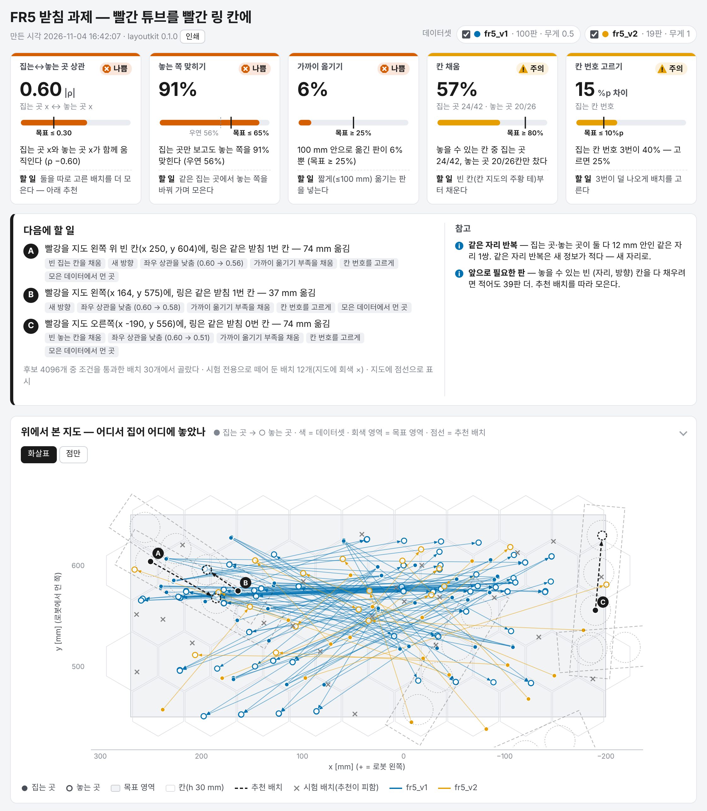

*머리줄 · 신호등 카드 · 다음에 할 일 · 위에서 본 지도. 카드 다섯 장 중 셋이 나쁨(주홍), 둘이 주의(주황)다.*

## 목차

1. [만들기와 열기](#1-만들기와-열기)
2. [머리줄](#2-머리줄)
3. [신호등 카드](#3-신호등-카드)
4. [다음에 할 일](#4-다음에-할-일)
5. [위에서 본 지도](#5-위에서-본-지도)
6. [칸 지도](#6-칸-지도)
7. [지름길](#7-지름길)
8. [옮긴 거리 · 칸 번호](#8-옮긴-거리--칸-번호)
9. [데이터셋 비교](#9-데이터셋-비교)
10. [시간표 · 수집 기록](#10-시간표--수집-기록)
11. [에피소드 표](#11-에피소드-표)
12. [상호작용 한눈에](#12-상호작용-한눈에)
13. [한국어 · 영어](#13-한국어--영어)
14. [인쇄와 PNG 내보내기](#14-인쇄와-png-내보내기)
15. [색과 모양](#15-색과-모양)
16. [이 문서의 그림](#16-이-문서의-그림)

## 1. 만들기와 열기

```bash
layoutkit analyze   DATA... --spec spec.json --out report.html            # 분석만
layoutkit recommend DATA... --spec spec.json --out report.html            # 분석 + 추천(다음에 할 일·점선·놓을 수 없는 칸 빗금)
layoutkit report result.json --out report_en.html --lang en               # 저장한 결과(--json)로 화면만 다시
```

파이썬에서는 `layoutkit.render(result, "report.html", lang="ko")` 다. 파일 크기는 받침 예제에서 약 180 kB, 에피소드 3000개 시험에서 4 MB 아래다.
화면은 폭 1120 px 를 넘지 않고, 좁은 화면(390 px)에서도 가로 스크롤이 생기지 않는다.

## 2. 머리줄

제목(`spec.title`, 없으면 `task`), 만든 시각, 버전, [인쇄] 단추, 데이터셋 칩이 있다.
칩마다 색 점 · 이름 · 판 수 · 무게가 보인다. 칩의 확인란을 끄면 그 데이터셋이 모든 그림·칸 지도 셈·표에서 빠진다(분석 숫자·카드는 그대로다).

## 3. 신호등 카드

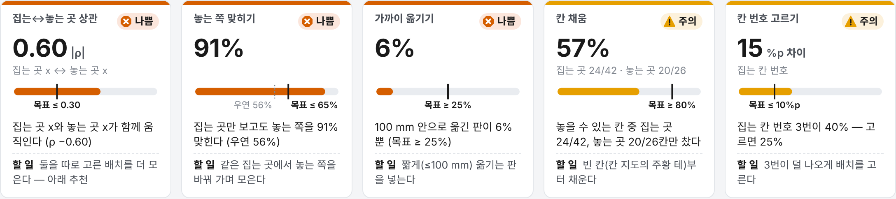

*받침 예제의 카드. 상관 0.60·맞힘 91 %·가까이 6 % 가 나쁨, 칸 채움 57 %·칸 번호 15 %p 가 주의다.*

카드 일곱 개 중 상태가 있는 다섯 개(상관 · 놓는 쪽 맞히기 · 가까이 옮기기 · 칸 채움 · 칸 번호 고르기)가 여기에 서고, 정보 카드 둘(같은 자리 반복 · 앞으로 필요한 판)은 '다음에 할 일' 오른쪽 '참고'에 간다.

| 자리 | 뜻 |
|---|---|
| 위 띠·딱지 | 상태(좋음 초록 · 주의 주황 · 나쁨 주홍). 딱지에 모양 아이콘과 글자가 같이 있다 |
| 큰 값 | 카드 값(\|ρ\|, %, %p 차이) |
| 보조 줄 | 상관 짝(집는 곳 x ↔ 놓는 곳 x), 칸 채움의 집는 · 놓는 칸 수, 치우친 이산 칸 이름 |
| 막대 계기 | 값 막대와 목표선(검은 세로선). '놓는 쪽 맞히기'에는 우연(많은 쪽 비율) 점선이 더 있다 |
| 왜 · 할 일 | 카드 `code` 를 사전 틀에 채운 두 줄 |

지표 정의와 문턱은 [ANALYSIS.md 7절](ANALYSIS.md#7-신호등-카드)에 있다.

## 4. 다음에 할 일

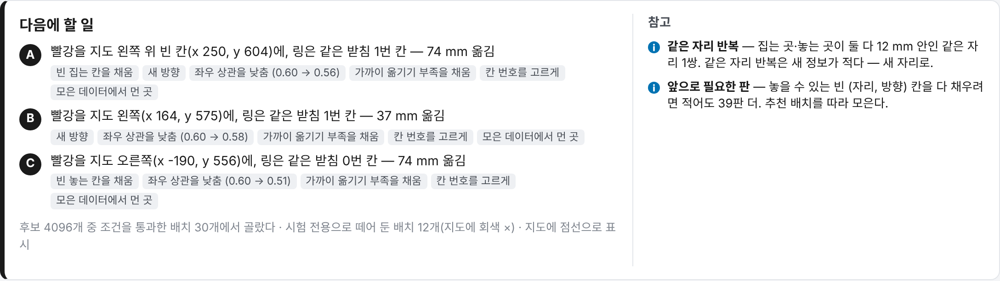

*추천 A·B·C. 문장 끝 꼬리표가 이유 코드다. 아래 회색 줄은 후보 수·통과 수·시험 배치 수.*

선택지마다 한 문장이다. "빨강을 지도 왼쪽 위 빈 칸(x 250, y 604)에, 링은 같은 받침 1번 칸 — 74 mm 옮김"처럼 물건 이름(`layout.items`), 지도 위치 말(왼쪽·가운데·오른쪽 × 위·가운데·아래, 화면 기준), 빈 칸 여부(집는 자리 칸에 판이 없을 때), 좌표, 고정물 칸, 옮긴 거리를 쓴다.
꼬리표는 이유 코드의 글이다([RECOMMEND.md 10절](RECOMMEND.md#10-이유-코드)). '좌우 상관을 낮춤'에는 지금 → 이 판을 더한 뒤 \|ρ\| 가 붙는다.
선택지 위에 마우스를 올리면 지도에서 그 추천이 진해진다.

아래 회색 줄: 후보 수와 통과한 배치 수, 시험 배치 수, 못 한 검사(`skipped_checks`), "지도에 점선으로 표시".
오른쪽 '참고'의 '앞으로 필요한 판'은 추천이 센 (자리, 방향) 칸 기준 N_min 이다(받침 예제 39). 명령 출력의 n_min(18, 자리 칸 기준)과 다르다 — [ANALYSIS.md 4.4](ANALYSIS.md#44-놓을-수-있는-칸과-n_min).

추천을 안 돌렸으면 "추천 없음 — recommend 를 같이 돌리면 여기에 다음 배치가 나온다"와 명령 예가 보인다.

## 5. 위에서 본 지도

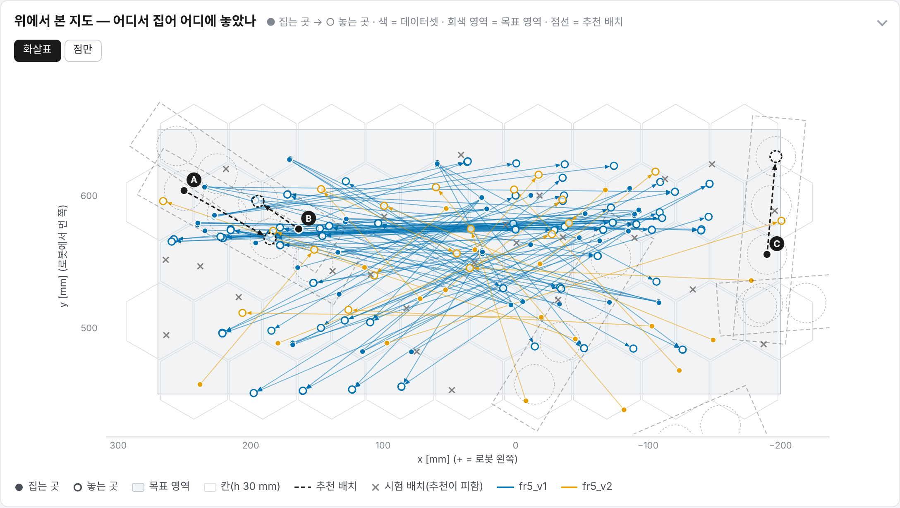

*● 집는 곳 → ○ 놓는 곳. 파랑 v1, 주황 v2. 회색 ×는 시험 배치, 검은 점선은 추천 A·B·C 와 그 받침 윤곽. 가로축은 +x 가 왼쪽이다.*

| 표시 | 뜻 |
|---|---|
| 회색 사각형 | 목표 영역(`area`) |
| 옅은 육각형 | 칸(h 30 mm) |
| 색 점 → 빈 원 | 에피소드 하나: 집은 자리 → 놓은 자리, 색 = 데이터셋 |
| 회색 × | 시험 전용 배치의 집는·놓는 자리(추천이 피한다) |
| 검은 점선 화살표 + 딱지 | 추천 선택지. 고정물이 있으면 점선 윤곽과 칸 원도 그린다 |

가로축 방향은 `frame.x_left_positive` 를 따른다. 받침 예제는 로봇 뒤에서 본 모습이라 +x 가 왼쪽이고 y 가 클수록 위(로봇에서 먼 쪽)다.

- [화살표] · [점만]: 화살표를 끄고 점만 본다. 겹친 판이 많을 때 칸 분포가 잘 보인다.
- 마우스를 점 가까이(12 px 안) 올리면 말풍선: id · 데이터셋 · 시각 · 결과 · 옮긴 거리 · 칸(집는 → 놓는) · 이산 칸 값 · 깃발 · 썸네일.
- 점을 누르면(또는 표의 줄을 누르면) 그 판을 고른다. 지도·산점·시간표에서 같은 판이 굵게 남고, 위에 '선택 id [선택 지우기] [표로 돌아가기]'가 뜬다. 판에 고정물 자세가 있으면 점선 윤곽도 그린다.

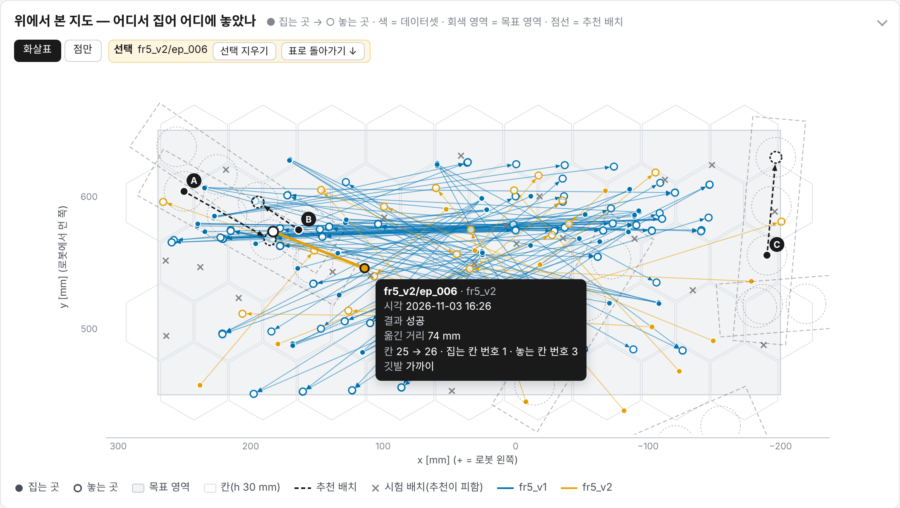

*표에서 v2 의 ep_006 줄을 누른 뒤 그 집는 점 위에 마우스를 올린 모습.*

## 6. 칸 지도

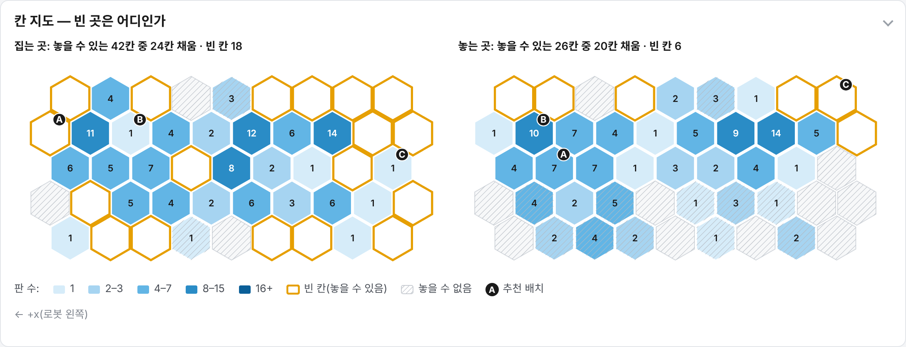

*왼쪽 집는 곳, 오른쪽 놓는 곳. 숫자는 그 칸의 판 수, 주황 테는 놓을 수 있는데 빈 칸, 빗금은 놓을 수 없는 칸, 검은 딱지는 추천이 쓰는 칸.*

- 제목: 추천을 돌렸으면 "놓을 수 있는 42칸 중 24칸 채움 · 빈 칸 18", 아니면 "47칸 중 20칸 채움".
- 칸 색: 판 수를 다섯 단계(1 · 2–3 · 4–7 · 8–15 · 16+, 최댓값이 16 을 넘으면 기하 간격)로 하늘 → 파랑 한 색 진하기로 칠한다.
- 주황 굵은 테: 놓을 수 있는데 빈 칸. 다음에 채울 곳이다.
- 빗금: 놓을 수 없는 칸(추천의 검사를 통과하는 후보가 하나도 안 드는 칸). 추천을 안 돌렸으면 빗금이 없고 모든 칸을 놓을 수 있다고 본다.
- 칸에 마우스: 칸 번호, 판 수(데이터셋별), 놓을 수 있는지.
- 머리줄 칩으로 데이터셋을 끄면 켠 데이터셋만 다시 센다.

칸 지도는 자리 칸(xy)이다. 추천의 '빈 칸'은 (자리, 방향) 칸이라, 판이 있는 칸에도 '새 방향' 이유로 추천이 갈 수 있다.

## 7. 지름길

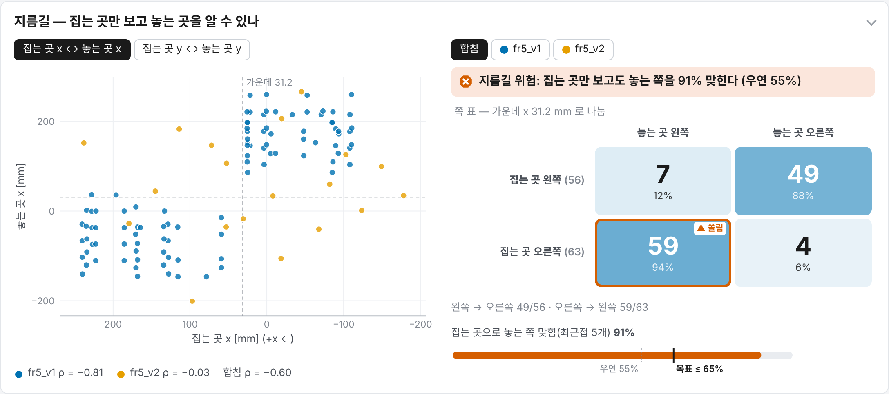

*왼쪽: 집는 곳 x ↔ 놓는 곳 x 산점과 기준선(점선). 오른쪽: 합친 쪽 표와 최근접 이웃 맞힘 계기.*

왼쪽 산점은 `spec.pairs` 짝마다 단추로 바꾼다. 점 색은 데이터셋, 범례에 데이터셋별 ρ 와 합친 ρ 가 있다. 쪽 표 축과 같은 짝이면 기준선을 점선으로 긋는다.
점이 왼쪽 위·오른쪽 아래 두 덩어리로 나뉘면(받침 v1) 집는 쪽만 보고 놓는 쪽을 안다는 뜻이다. v2(주황)는 네 칸에 흩어져 있다.

오른쪽:

- 맨 위 판정 줄: 맞힘이 `predict_good` 이하면 "지름길 없음", `predict_bad` 이하면 "지름길 조금", 그 위면 "지름길 위험".
- 쪽 표: 행 = 집는 쪽, 열 = 놓는 쪽(화면 방향). 칸마다 판 수와 행 안 비율, 비율만큼 진한 파랑. 행이 5판 이상이고 한 칸이 90 % 이상이면 주황 테와 '▲ 쏠림'.
- 계기: 최근접 이웃(5개) 맞힘, 우연(많은 쪽 비율) 점선, 목표선.
- [합침] · [데이터셋] 단추: 데이터셋마다 그 데이터셋만의 기준선으로 다시 그린 쪽 표와 맞힘이다(비교 표의 값과 같다). 받침 예제에서 쪽 표 맞힘 · 최근접 이웃 맞힘은 v1 96 % · 100 %, v2 63 % · 58 % 다.

## 8. 옮긴 거리 · 칸 번호

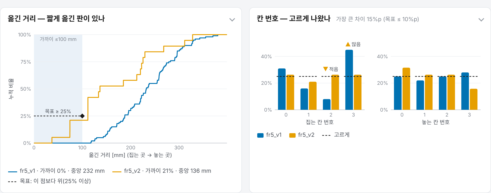

*왼쪽: 옮긴 거리 누적 분포. 오른쪽: 집는·놓는 칸 번호 비율(데이터셋별)과 고르게 점선.*

옮긴 거리(왼쪽):

- 데이터셋마다 계단 누적 분포다. 옅은 파랑 띠가 '가까이'(≤ near_mm) 구간이다.
- 검은 점선과 마름모는 목표(가로 near_mm, 세로 near_share)다. 곡선이 마름모보다 위를 지나면 가까이 비율이 목표 이상이다. v1(파랑)은 120 mm 앞까지 0 이다.
- 마우스를 올리면 그 거리 이하 비율을 데이터셋마다 보인다.

칸 번호(오른쪽):

- `spec.strata` 마다 막대 그림 하나. 값마다 데이터셋별 비율 막대, 목표 비율 점선.
- 합친(무게) 비율이 목표에서 `strata_dev_good` 보다 벗어나면 '▲ 많음' · '▼ 적음' 표시(주의 주황, `strata_dev_bad` 보다 크면 나쁨 주홍).
- 패널 제목 옆에 가장 큰 차이와 목표가 있다.

## 9. 데이터셋 비교

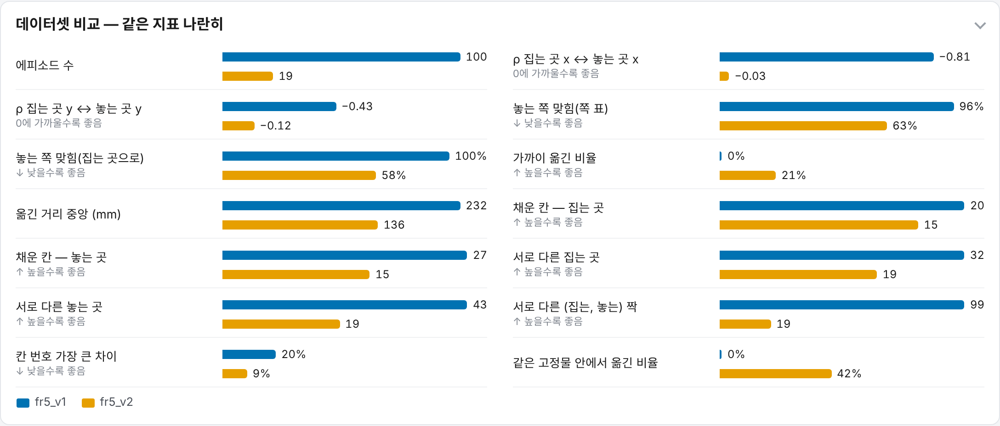

*같은 지표를 데이터셋마다 나란히. 줄 아래 회색 글이 좋은 쪽(낮을수록 · 높을수록 · 0 에 가까울수록).*

데이터셋이 둘 이상일 때만 나온다. 비율 지표는 0~100 % 눈금, 개수 지표는 줄 안 최댓값 기준 막대다. 지표 목록은 [ANALYSIS.md 8절](ANALYSIS.md#8-데이터셋-비교)에 있다.

## 10. 시간표 · 수집 기록

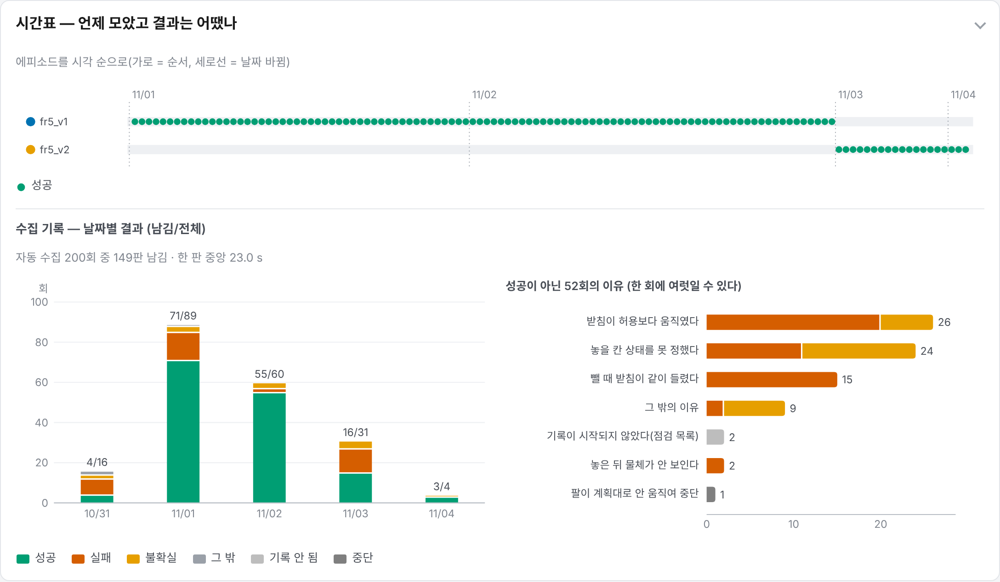

*위: 데이터셋별 에피소드 순서(점 = 결과). 아래: 실행 기록 200회의 날짜별 결과와 성공이 아닌 52회의 이유.*

시간표:

- 데이터셋마다 한 줄. 에피소드를 시각 순으로 늘어놓는다. 가로축은 순서이고 시간 간격이 아니다. 날짜가 바뀌는 곳에 점선과 월/일.
- 점 모양·색은 결과다(15절). 점에 마우스를 올리거나 누르면 지도와 같이 움직인다.

수집 기록(`--runs` 를 줬을 때):

- 날짜별 막대: 결과별로 쌓고, 위 숫자는 남긴 판 / 실행 수다.
- 이유 막대: 이유 code 마다 결과별로 쌓는다. 실행 한 번에 이유가 여럿일 수 있어 합이 실행 수보다 크다.
- 부제: 실행 수 · 남긴 판 · 실행 시간 중앙(전체 실행 기준).

## 11. 에피소드 표

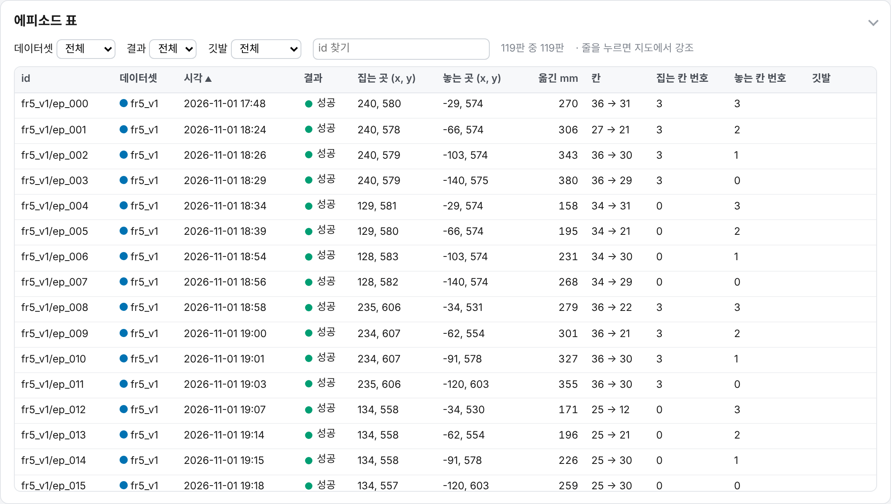

*거르기(데이터셋 · 결과 · 깃발 · id 찾기)와 정렬. 줄을 누르면 지도에서 그 판을 강조한다.*

| 열 | 뜻 |
|---|---|
| 그림 | 썸네일이 있는 데이터일 때만(fr5rec 첫 3인칭 사진 등) |
| id · 데이터셋 · 시각 · 결과 | |
| 집는 곳 · 놓는 곳 (x, y) | mm |
| 옮긴 mm | |
| 칸 | 집는 칸 → 놓는 칸 번호 |
| strata 열 | `spec.strata` 마다(예 집는 칸 번호 · 놓는 칸 번호) |
| 깃발 | 같은 자리 · 가까이 · 영역 밖 · 결과로 뺌 |

- 머리를 누르면 정렬(다시 누르면 반대). 기본은 시각 오름차순.
- 거르기: 데이터셋, 결과, 깃발(전체 · 없음 · 깃발마다), id 찾기. 위에 "119판 중 119판"처럼 보인 수가 나온다.
- 줄에 마우스 → 지도·산점·시간표 강조, 누르기 → 선택(지도가 화면 밖이면 지도로 스크롤).
- 표는 520 px 높이 안에서 스크롤한다. 자리가 없어 분석에 못 쓴 판 수는 패널 제목 옆에 적는다.

썸네일은 HTML 파일 기준 상대 경로 그림이나 `data:image/` URI(하나 40,000자 이하, 합 3,000,000자 이하)만 넣는다. 상대 경로 그림은 HTML 을 데이터 폴더 기준 같은 자리에 둘 때 보인다.

## 12. 상호작용 한눈에

| 하는 것 | 어디서 | 결과 |
|---|---|---|
| 데이터셋 켜기/끄기 | 머리줄 칩 | 모든 그림·칸 지도 셈·표에서 빼기 |
| 화살표/점만 | 지도 위 단추 | 화살표 숨김 |
| 마우스 올리기 | 지도·산점·시간표의 점, 칸, 막대, 누적 분포 | 말풍선 |
| 점·줄 누르기 | 지도·산점·시간표·표 | 같은 판을 모든 그림에서 굵게, 선택 칩 |
| 짝 바꾸기 | 지름길 왼쪽 단추 | 다른 (출발, 목표) 짝 산점 |
| 합침 · 데이터셋 | 지름길 오른쪽 단추 | 데이터셋마다 쪽 표·맞힘 |
| 추천 위에 마우스 | 다음에 할 일 목록 | 지도에서 그 추천 진하게 |
| 정렬 · 거르기 | 표 | |
| 접기/펴기 | 패널 제목 | 패널 접기 |
| 인쇄 | 머리줄 [인쇄] | 모든 패널을 펴고 인쇄 |

## 13. 한국어 · 영어

화면 말은 `--lang en`(또는 spec `lang`)으로 바꾼다. 저장한 결과로 말만 바꿔 다시 그릴 수 있다.

```bash
layoutkit report result.json --out report_en.html --lang en
```

축 이름 `frame.x_label`·`y_label` 은 화면 말이 spec 의 `lang` 과 같을 때만 쓴다. 물건·고정물 이름은 `i18n.NAMES`(red · yellow · ring · rack · tube …)에 있으면 번역하고, 없으면 spec 의 이름을 그대로 쓴다.

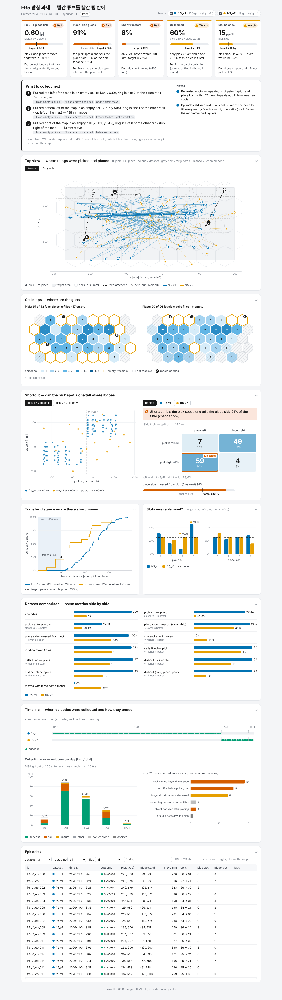

*영어 화면 전체(시험용 결과로 찍은 것 — 16절).*

## 14. 인쇄와 PNG 내보내기

인쇄: [인쇄] 단추나 브라우저 인쇄. 인쇄할 때는 모든 패널을 펴고, 단추·거르기·말풍선을 숨기고, 표 높이 제한을 푼다. 배경은 밝은 색이다.

PNG: `--png DIR` 을 주면 matplotlib 으로 주요 패널을 따로 그린다(`report/figures.py`, 160 dpi).

```bash
layoutkit analyze DATA... --spec spec.json --png fig_out/
```

| 파일 | 내용 |
|---|---|
| `map.png` | 위에서 본 지도(시험 배치·추천 포함) |
| `cells.png` | 칸 지도 두 장 |
| `shortcut.png` | 산점 + 쪽 표 |
| `transfer.png` | 옮긴 거리 누적 분포 |
| `strata.png` | 이산 칸 막대 |
| `runs.png` | 수집 기록(실행 기록이 있을 때만) |

한국어 글꼴(Noto Sans CJK KR · Noto Sans KR · Apple SD Gothic Neo · Malgun Gothic · NanumGothic · Noto Sans CJK JP)을 못 찾으면 영어로 그린다. matplotlib 이 없으면 그림을 만들지 않고 넘어간다.

## 15. 색과 모양

| 쓰임 | 색 |
|---|---|
| 데이터셋 순서 | 파랑 #0072B2 · 주황 #E69F00 · 초록 #009E73 · 보라 #CC79A7 · 하늘 #56B4E9 · 주홍 #D55E00 (Okabe–Ito). `spec.dataset_colors` 로 바꾼다 |
| 상태 | 좋음 #009E73 · 주의 #E69F00 · 나쁨 #D55E00 · 정보 #0072B2 |
| 칸 셈 | #D6ECF9 → #A6D4F1 → #62B5E5 → #2A8CC6 → #0B5F98 |
| 추천 | 검정 #1A1A1A 점선 |

결과 표시는 색과 모양을 같이 쓴다.

| 결과 | 모양 · 색 |
|---|---|
| 성공 | 채운 원 · 초록 |
| 실패 | × · 주홍 |
| 불확실 | 삼각형 · 주황 |
| 기록 안 됨 | 사각형 · 옅은 회색 |
| 중단 | 마름모 · 회색 |
| 모름 | 빈 원 · 회색 |

## 16. 이 문서의 그림

패널 그림(`fig/panel_*.png`, `fig/overview.png`, `fig/capstone_overview.png`)은 `layoutkit demo` 와 캡스톤 예제 화면을 Playwright(Chromium, 폭 1280 px, deviceScaleFactor 2)로 요소마다 찍은 것이다.
`fig/dashboard_ko.png`·`dashboard_en.png` 는 `tests/test_report.py` 가 시험용 결과(`tests/fixtures/result_rack.json`)로 찍는 전체 페이지다. 시험용 결과는 화면 개발용이라 칸 채움·추천 같은 숫자가 demo 와 조금 다르다.
