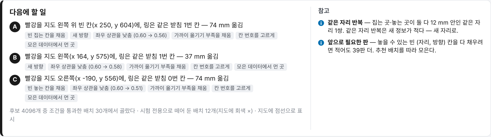

# 배치 추천

다음 에피소드에 물체를 어디서 집어 어디에 놓을지(고정물이 있으면 고정물을 어디에 어느 방향으로 둘지)를 계산한다. 로봇은 움직이지 않는다.
빈 칸을 먼저 채우고, 집는 자리와 놓는 자리 사이 상관(지름길)을 줄이고, 이산 칸(칸 번호·색·이동 종류)을 고르게 하는 배치를 선택지 A·B·C 로 낸다.

수학은 FR5-AutoCollect 의 받침 과제 추천기(`fr5auto/rackrec.py`)와 같다. 받침에 묶인 부분만 spec 으로 바꿨다: 배치 변수 = `spec.layout`, 놓을 수 있는 영역 = `spec.constraints`, 카메라 = `spec.cameras`.
코드는 `layoutkit/recommend/` 다.

## 목차

1. [흐름](#1-흐름)
2. [후보 뽑기](#2-후보-뽑기)
3. [놓을 수 있는 칸](#3-놓을-수-있는-칸)
4. [점수](#4-점수)
5. [빼기](#5-빼기)
6. [고르기](#6-고르기)
7. [선택지 A · B · C](#7-선택지-a--b--c)
8. [시험 배치](#8-시험-배치)
9. [선택지 모양](#9-선택지-모양)
10. [이유 코드](#10-이유-코드)
11. [큐 — 목표와 지운 판](#11-큐--목표와-지운-판)
12. [fr5auto 와 같은지](#12-fr5auto-와-같은지)
13. [예제 결과](#13-예제-결과)
14. [한계](#14-한계)
15. [참고문헌](#참고문헌)

## 1. 흐름

```bash
layoutkit recommend fr5_v1=examples/rack_fr5/data/v1_tags.json fr5_v2=examples/rack_fr5/data/v2_layouts_20261103.json \
    --weight fr5_v1=0.5 --spec examples/rack_fr5/spec.json --n 3 --seed 1 --out report.html
```

```python
import layoutkit as lk
v1 = lk.load_dataset("examples/rack_fr5/data/v1_tags.json", name="fr5_v1", weight=0.5)
v2 = lk.load_dataset("examples/rack_fr5/data/v2_layouts_20261103.json", name="fr5_v2")
res = lk.analyze([v1, v2], "examples/rack_fr5/spec.json")
rec = lk.recommend([v1, v2], "examples/rack_fr5/spec.json", result=res, n=3, seed=1)
for o in rec["options"]:
    print(o["label"], o["start"], o["goal"], o["why_codes"])
```

`result` 를 주면 그 칸(`coverage.centers`)을 쓰고, `result["recommend"]` 와 `coverage` 의 `reach`·`n_min`·카드를 채운다. 없어도 돈다.
데이터셋 목록의 마지막이 '지금 모으는 묶음'이다(상관 항이 이 묶음만의 상관도 본다). `spec.recommend.target_dataset` 으로 바꾼다.

순서: 후보 뽑기 → 검사 → 점수 → 빼기 → 고르기 → (final 훅) → 선택지.

## 2. 후보 뽑기

`recommend.n_cand`(기본 4096)개를 Halton 수열에 무작위 이동(Cranley–Patterson)을 더해 뽑는다(`sample.halton`). 낮은 불일치로 고르게 덮고 scipy 가 필요 없다. 밑은 소수 2, 3, 5, 7, … 이다.

points:

- 집는 자리 x·y, 놓는 자리 x·y 를 `start_area`·`goal_area`(없으면 `area`)에서 뽑는다. `start_yaw`·`goal_yaw` 가 있으면 yaw 도 뽑는다.
- `layout.discrete` 는 값 중 고르게 뽑는다.

fixtures:

- 고정되지 않은 인스턴스마다 3차원(x, y, 줄 방향)을 쓴다. 가운데 x·y 는 영역을 칸 줄 반 길이만큼 넓힌 범위에서 뽑는다(가장자리 칸도 영역에 들 수 있게).
- 줄 방향은 `yaw_range` → `yaw_window`(그 자리 창 가운데 ± 반폭) → 전 범위 순으로 정한다.
- `order: "x"` 인 형식은 인스턴스 번호를 x 작은 쪽부터 다시 매긴다.
- start 고정물 a 는 start 형식 인스턴스 중 고르게, (start 칸, 장애물 칸)은 서로 다른 칸 순열 중 고르게 뽑는다.
- goal 고정물 b 는 같은 고정물 허용이면 goal 형식 인스턴스 중 고르게, 아니면 a 가 아닌 것이다. `rule` 이 있으면 규칙 변수를 먼저 뽑고 b 를 규칙으로 정한 뒤, a 를 b 가 아닌 start 형식 중에서 고른다(`start_differs`).
- goal 칸은 남은 빈 칸 중 고르게 뽑는다.

받침 spec(형식 하나 × 2, 칸 4, 장애물 하나, 같은 받침 허용)에서는 난수를 `rackrec.sample` 과 같은 순서로 쓴다. 같은 시드면 같은 후보가 나온다(12절).

후보 묶음 `C`(훅이 받는 것):

| 키 | 모양 | 뜻 |
|---|---|---|
| `kind` · `n` | | `points` · `fixtures`, 후보 수 N |
| `g` · `q` | N×3 | 집는 자리·놓는 자리 (x, y, ψ). fixtures 면 ψ = 그 고정물 줄 방향 |
| `disc` | {이름: N} | 이산 변수 값 번호 |
| `P` · `yaw` | N×F×2 · N×F | 고정물 가운데·줄 방향(F = 모든 인스턴스) |
| `H` | N×F×S×2 | 칸 xy(없는 칸 NaN) |
| `a` · `ks` · `obs` · `b` · `kg` | N | start 고정물·칸, 장애물 칸, goal 고정물·칸 |

검사는 [SPEC.md 5절](SPEC.md#5-constraints--놓을-수-있는-배치-검사)의 순서대로 돈다. 처음 걸린 검사마다 센 수가 `drop` 이다.

## 3. 놓을 수 있는 칸

영역 밖·창 밖·안 보이는 칸은 아무리 모아도 못 채운다. 그래서 고정 시드(20261102)로 `n_reach`(기본 4 × n_cand = 16384)개 후보를 뽑아 검사를 다 통과한 후보가 하나라도 드는 칸을 '놓을 수 있는 칸'으로 둔다(`recommend.reach(spec)`, rackrec `Recommender.reach` 와 같다). spec 마다 한 번 계산해 기억한다.

칸은 두 가지로 센다.

- (자리, 방향) 칸: 육각 자리 칸 × 방향 칸. 고르기의 '빈 칸'과 `recommend.cells.n_min` 이 이것이다. 방향 칸은 고정물 줄 방향 기준이다(points 에서 yaw 를 안 뽑으면 방향 칸 1).
- 자리 칸: 분석의 칸 지도와 같은 xy 칸. 분석 결과의 `coverage.*.reach` 와 n_min 카드가 이것이다.

받침 spec: 통과 121 / 16384, 놓을 수 있는 (자리, 방향) 칸 집는 60 · 놓는 41, 자리 칸 집는 42 · 놓는 26.

## 4. 점수

$$
\begin{aligned}
\mathrm{score} ={}& \sigma^2_g + \sigma^2_q + \alpha\,\sigma^2_r + \beta \sum_f \frac{1}{1 + \tilde n_f} - \eta\,\Delta\rho - \gamma\,E \\
&+ \sum_{c} w_c\,\tfrac12\left(\frac{1}{1 + m_{c,s}} + \frac{1}{1 + m_{c,g}}\right) + b_\text{vis}\,\mathbf 1[\text{goal 보임}] - w_\text{bad}\,P_\text{bad}
\end{aligned}
$$

| 항 | 뜻 | 기본 |
|---|---|---|
| σ²_g + σ²_q + α σ²_r | 집는 자리·놓는 자리·옮김 방향(r = q − g, xy)의 새로움. 가우스 과정 사후 분산 | α 0.5 |
| β Σ 1/(1 + ñ_f) | 이산 칸 묶음 f 마다 후보가 드는 칸의 채움. ñ = 무게 합 / (목표 비율 × 칸 수). 덜 찬 칸 우대 | β 0.3 |
| −η Δρ | 상관을 줄이면 점수가 오른다 | η 1.0 |
| −γ E | 지금 탁자 장면에서 옮길 수고(장면을 모르면 0) | γ 0.15 |
| w_c · ½(…) | 카메라마다 정책 입력 칸(policy_px² 을 img_grid² 칸으로)에 집는·놓는 점이 아직 덜 든 칸 우대. m = 그 칸 무게 합 | 카메라 `policy_weight`(받침 0.4) |
| b_vis · 1[…] | `goal_visible` 에 `bonus` 가 있으면 표시물이 보이는 후보 우대 | 받침 0.2 |
| −w_bad P_bad | 인식이 고정물을 못 찾았던 자리(큐 `bad_view`) 근처 벌점 | 0.8 |

가우스 과정 사후 분산. S 는 저장된 판(실제로 놓인 자리), 거리는 눈금을 맞춘 유클리드 거리다(ψ 는 주기로 감는다).

$$d^2 = \left(\frac{\Delta x}{h_{xy}}\right)^2 + \left(\frac{\Delta y}{h_{xy}}\right)^2 + \left(\frac{\mathrm{wrap}(\Delta\psi)}{h_\psi}\right)^2, \qquad k = \exp(-\tfrac12 d^2)$$

$$\sigma^2_S(c) = 1 - k_c^\top (K_S + \Lambda)^{-1} k_c, \qquad \Lambda = \mathrm{diag}(\lambda / w_i),\ \lambda = 0.05$$

무게가 작은 판은 덜 아는 것으로 친다. 판이 없으면 1 이다. σ² 가 큰 곳을 고르는 것은 최대 엔트로피 표본 추출이다 [Shewry & Wynn 1987].

이산 칸 묶음 f 는 `spec.strata` 에 자동 묶음 둘을 더한 것이다(`recommend.auto_strata`). '가까이'(목표 비율 near_share)와, fixtures 이고 장애물이 있으면 '장애물 이웃'(start 칸과 장애물 칸이 붙음, 50/50)이다.

상관 항. 판 하나를 더했을 때의 무게 상관을 후보마다 닫힌 꼴로 계산한다(`score.wcorr_add`). 새 묶음(target_dataset)이 `rho_v2_n`(10)판 이상이면 합친 상관과 새 묶음만의 상관 중 큰 쪽을 줄인다(최소최대).
합친 상관만 0 으로 맞추면 새 묶음 혼자 반대 상관이 남기 때문이다. 판 하나가 바꾸는 상관에 무게 합을 곱해 다른 항과 같은 크기로 만들고 ±1 로 자른다.

$$\Delta\rho = \mathrm{clip}\Big((m_1 - m_0)\big(\textstyle\sum_i w_i + 1\big),\,-1,\,1\Big), \qquad m = \max\big(|\rho_\text{pool}|,\ |\rho_\text{new}|\big)$$

줄일 짝은 `recommend.rho_pairs`(기본 `spec.pairs` 첫 짝)다.

수고 항. `scene`(또는 큐의 `scene`)으로 지금 탁자를 알 때만 계산한다.

$$E = \min_\text{짝} \sum_{i}\left(\frac{\lVert\Delta p_i\rVert}{100\ \text{mm}} + \frac{|\mathrm{wrap}(\Delta\psi_i)|}{45^\circ}\right) + 0.5\,n_\text{옮길 물건} + 0.2\,\mathbf{1}[\text{goal 표시물 옮김}]$$

짝은 움직이는 같은 형식 고정물끼리의 순열 중 작은 쪽이다. 장면 모양: `{"fixtures": [{"x","y","yaw"}], "start": [i, k], "obstacles": [[i, k]], "goal": [i, k]}`(rackrec 의 `racks`·`red`·`yellow`·`slot` 도 받는다).

인식 실패 벌점. 큐 `bad_view` 의 고정물 자세마다 후보 고정물과의 exp(−½d²) 최댓값을 더하고 2 로 자른다. 빼지 않고 점수만 낮춘다.

## 5. 빼기

- 시험 배치 근처: 집는·놓는 쪽 모두 눈금 거리 0.5(약 0.5 h) 안이면 뺀다(`drop.near_holdout`).
- 저장 판과 거의 같음: 집는·놓는 쪽 모두 0.5 안이고, fixtures 면 칸 번호(ks, kg)까지 같으면 뺀다(`drop.dup_saved`).
- 집는·놓는 자리가 칸 밖이면 뺀다.

## 6. 고르기

1. 후보마다 집는 칸·놓는 칸((자리, 방향) 칸)의 무게 합 n_s, n_g 를 센다. 수준 ℓ = max(n_s − min n_s, n_g − min n_g) 가 가장 낮은 후보만 남긴다.
2. 이번 판의 이동 종류를 정한다. 남은 판 n_rem(`goal` 인자, 없으면 (자리, 방향) 칸 N_min)으로 가까이 비율 목표를 맞추는 확률을 구하고 그 확률로 '가까이'를 뽑는다.

$$p_\text{near} = \mathrm{clip}\!\left(\frac{\text{near\_share}\,(W + n_\text{rem}) - W_\text{near}}{n_\text{rem}},\ 0,\ 1\right)$$

3. 합친 \|ρ\| 가 `rho_max` 를 넘으면 \|ρ\| 를 키우지 않는 후보만 남긴다.
4. 남는 후보가 없으면 조건을 차례로 푼다: (상관 · 이동 · ℓ 최소) → (상관 · ℓ 최소) → (ℓ 최소) → (ℓ + 0.5) → (ℓ + 1) → (제한 없음). 푼 조건은 선택지 `relax` 와 이유 코드 `relaxed` 에 남는다.
5. 남은 후보를 점수 순으로 위 `top_k`(30)개만 두고 온도 T = `temp`(0.15)의 softmax 로 하나를 뽑는다.

$$P(i) = \frac{\exp\big((s_i - s_\text{max})/T\big)}{\sum_j \exp\big((s_j - s_\text{max})/T\big)}$$

6. final 훅이 있으면 뽑힌 후보에 돌린다. 못 통과하면 빼고 다시 뽑는다. 훅 호출은 선택지를 다 합쳐 `n_plan`(20)번까지다.

점수 1등만 고르지 않는 것은 칸을 빨리 채우기 위해서다. 최고점은 판마다 비슷한 곳으로 몰린다. T = 0 이면 1등만 고른다.

## 7. 선택지 A · B · C

| | 고르는 법 |
|---|---|
| A | 6절 결과(`how: "softmax"`) |
| B | 6절에서 남은 후보 중 점수 ≥ A − 0.1\|A\| 인 것을 수고 오름차순으로 8개까지 보고, A 와 고정물 자세가 다르고 final 훅을 통과한 첫 것(`how: "low_effort"`). 장면을 모르면 수고가 모두 0 이라 A 근처 점수의 다른 배치다 |
| C | 이산 칸 중 채움 비율이 가장 낮은 칸에 드는 후보(빼기만 통과하면 됨)를 점수 순으로 6개까지 보고 통과한 첫 것(`how: "strata"`, `strata_fill` 에 그 칸) |
| D, E … | `--n` 이 3보다 크면 남은 위 후보에서 softmax 로 더 |

큐에 '다시 모을 목표'(지운 판의 목표)가 있으면 A 는 그 목표를 그대로 보이고(`how: "keep"`, 이유 `retry_deleted`), 새로 계산한 A 는 A2 가 된다.

## 8. 시험 배치

`spec.holdout` 이 0 보다 크면 학습에 쓰지 않을 배치를 그만큼 떼어 둔다. 재평가가 '처음 보는 배치'를 정확히 재게 하려는 것이다.

k-center 탐욕법 [Gonzalez 1985]: 시드 0 으로 후보를 뽑아 검사를 통과한 것 중에서, 이미 있는 판에서 가장 먼 배치를 고르고, 그다음부터는 이미 고른 시험 배치와 판 모두에서 가장 먼 배치를 차례로 고른다. 거리는 √(d_g² + d_q²)(4절 눈금)다. id 는 `T01`, `T02` … 다.

큐를 주면 처음 한 번 정해 큐에 남기고 다음부터 그대로 쓴다. 큐 없이 부르면 부를 때마다 지금 데이터 기준으로 다시 정한다(시드가 0 이라 같은 데이터면 같다).
학습 추천은 5절에서 시험 배치 근처를 뺀다. 선택지마다 가장 가까운 시험 배치까지 거리(`holdout_dist_h`)가 남는다.

## 9. 선택지 모양

```json
{"label": "A", "how": "softmax", "p": 0.117,
 "start": {"x": 250.3, "y": 603.8, "yaw": 29.3, "fixture": "rack1", "slot": 3},
 "goal":  {"x": 185.4, "y": 567.4, "yaw": 29.3, "fixture": "rack1", "slot": 1},
 "fixtures": [{"name": "rack0", "type": "rack", "x": ..., "y": ..., "yaw": ..., "fixed": false}, {"name": "rack1", ...}],
 "items": [{"name": "red", "role": "start", "fixture": "rack1", "slot": 3}, {"name": "yellow", "role": "obstacle", ...}, ...],
 "discrete": {"start_slot": 3, "goal_slot": 1, "same_fixture": true, "arrangement": "○○YR", "adjacent": true, "near": true},
 "move_mm": 74.4, "score": 3.691,
 "parts": {"var_start": 0.99, "var_goal": 0.987, "var_move": 0.802, "strata": 0.272, "coupling": -1.0, "effort": 0.0,
           "img": 0.031, "vis": 0.2, "bad_view": 0.0},
 "cells": {"start": 37, "goal": 26, "start_id": 111, "goal_id": 78, "start_count": 0.0, "goal_count": 0.0,
           "start_xy_count": 0.0, "goal_xy_count": 4.0},
 "rho": {"now": 0.604, "after": 0.563}, "holdout_dist_h": 3.62,
 "vis": {"third": {"goal_frac": 1.0, "goal_minor_px": 8.48}},
 "policy_cells": {"third": {"start": 42, "goal": 43, "start_empty": false, "goal_empty": false}},
 "effort_text": "effort: scene unknown → 0",
 "why_codes": ["empty_start_cell", "new_yaw", "lowers_coupling", "adds_near", "balances_strata", "far_from_data"],
 "why_args": {"new_yaw": ["goal"], "rho": [0.604, 0.563], "strata": ["goal_slot=1", "adjacent=True"], "far_from_data": ["start", "goal"]},
 "feat": {"g": [...], "q": [...]}}
```

fixtures 에서 `start.yaw`·`goal.yaw` 는 고정물 줄 방향이다(에피소드의 잡는 손목 각이 아니다). `parts.coupling` 은 −η 를 곱하기 전 Δρ 다.

`recommend()` 가 돌려주는 묶음에는 선택지 밖에 이것도 있다.

| 키 | 뜻 |
|---|---|
| `n_cand` · `n_feasible` · `n_ok` | 후보 수 · 검사 통과 · 빼기까지 통과 |
| `drop` | 검사별로 처음 걸린 수 + `near_holdout` · `dup_saved` |
| `skipped_checks` | 못 한 검사와 이유 |
| `holdout` | 시험 배치 목록 |
| `cells` | 칸 수·놓을 수 있는 칸·채운 칸·(자리, 방향) N_min · reach 계산의 통과 수와 drop |
| `select` | 고르기 상태(남은 후보 수, 수준, p_near, 뽑은 이동 종류, 푼 조건 …) |
| `rho0` · `near_share` · `seed` · `weights` · `target_dataset` · `n_episodes` | |
| `why` | 선택지가 없을 때 이유(`no_feasible` · `all_near_holdout_or_dup` · `final_check_failed` · `no_option`) |

## 10. 이유 코드

선택지 `why_codes` 는 화면이 `i18n.WHY` 로 글을 만든다.

| code | 붙는 조건 | 화면 글 |
|---|---|---|
| `empty_start_cell` | 집는 자리 칸(xy)에 판이 없다 | 빈 집는 칸을 채움 |
| `empty_goal_cell` | 놓는 자리 칸(xy)에 판이 없다 | 빈 놓는 칸을 채움 |
| `new_yaw` | 자리 칸에는 판이 있는데 이 (자리, 방향) 칸은 비었다 | 새 방향 |
| `lowers_coupling` | 상관 항 Δρ < 0(`why_args.rho` = [지금, 뒤]) | 좌우 상관을 낮춤 |
| `adds_near` | 가까이 옮김이고 지금 가까이 비율이 목표 아래 | 가까이 옮기기 부족을 채움 |
| `balances_strata` | 이 후보가 드는 이산 칸이 그 묶음에서 가장 덜 찼다(선택지 C 는 늘) | 칸 번호를 고르게 |
| `low_effort` | 장면을 알고, B 이거나 남은 후보 중 수고가 가장 적다 | 지금 장면에서 덜 옮김 |
| `far_from_data` | σ²_g 또는 σ²_q ≥ 0.5 | 모은 데이터에서 먼 곳 |
| `relaxed` | 6절 4단계에서 조건을 풀었다 | 조건을 조금 풀어서 고름 |
| `retry_deleted` | 큐의 다시 모을 목표 | 지운 판 다시 |

## 11. 큐 — 목표와 지운 판

수집기와 붙여 쓸 때 쓰는 작은 JSON 상태다. 기준은 언제나 저장된 에피소드다. 판을 지우면 그 목표는 다시 '모을 것'으로 돌아간다.

```python
from layoutkit.recommend import recommend, queue_new, queue_load, queue_save, queue_add, queue_recorded, queue_sync, queue_next

q = queue_load("queue.json")                 # 없으면 queue_new()
rec = recommend(datasets, spec, queue=q)     # 시험 배치는 처음 한 번 정해 q["holdout"] 에 남는다
t = queue_add(q, rec["options"][0])          # 목표 R0001 … — 수집 쪽은 이 번호를 에피소드 rec_id 로 남기면 맞추기가 정확하다
queue_recorded(q, t["id"])                   # 그 목표로 한 판 녹화(저장 여부와 무관)
queue_sync(q, saved_episodes)                # 저장된 판으로 목표 상태(collected · pending) 다시 계산
queue_save("queue.json", q)
```

| 함수 | 하는 일 |
|---|---|
| `queue_new()` | `{"holdout", "targets", "next_id", "current", "scene", "bad_view"}` |
| `queue_add(q, option)` | 선택지 → 목표(`R0001` …, status pending) |
| `queue_recorded(q, id)` | 녹화 횟수 +1 |
| `queue_match(q, episodes, tol_mm=30)` | 저장된 판 → 목표. `rec_id` 가 있으면 그것, 없으면 집는·놓는 자리 둘 다 30 mm 안인 가까운 목표(목표 하나에 판 하나) |
| `queue_sync(q, episodes, per_pose=1)` | 목표마다 맞는 판 수로 collected · pending. 한 번 저장됐던 목표는 `kept_once` |
| `queue_next(q)` | 녹화했거나 한 번 저장됐는데 지금 저장된 판이 없는 목표 중 가장 오래된 것 — 다음 추천의 A |

`rec_id` 는 에피소드의 맨 위 · `discrete` · `extra` · `meta` 중 있는 곳에서 읽는다.

## 12. fr5auto 와 같은지

`tests/test_recommend.py` 가 확인한다.

- 카메라 투영: 실물 3인칭 보정에서 fr5auto `camera.project_world` 로 잰 기준 점 6개와 0.01 px 안(이 환경에서 1.1e-13 px). FR5-AutoCollect 가 옆에 있으면 무작위 500점도 비교한다(`dist_flip` 참·거짓 둘 다).
- 놓을 수 있는 영역: 받침 spec, 후보 16384개(시드 20261102) 중 통과 121개, (자리, 방향) 칸 60 · 41. FR5-AutoCollect 가 있으면 `rackrec.sample` 의 후보 좌표·줄 방향이 같고 통과 집합이 원소까지 같은지 본다(이 환경에서 통과).

다른 점:

- rackrec 은 영역·탁자·손목 창을 검사 ① 하나로 센다. 여기서는 area · yaw_window · reach · in_view 로 나눠 센다. 통과 집합은 같고 `drop` 의 나눔만 다르다.
- rackrec 의 계획 검사(⑦, 역기구학·궤적)는 로봇 모델이 필요해 넣지 않았다. 같은 자리에 final 훅을 부른다.
- 받침 예제 spec 에는 손목 카메라가 없다. fr5auto 실물 셀의 '초기 자세 손목 화면에 받침 둘이 다 보이는 배치' 조건(`rec.wrist_full_racks`)은 이 비교에 들어 있지 않다.

## 13. 예제 결과

받침(`layoutkit demo`, 시드 1): 후보 4096개 중 검사 통과 30개(area 2854 · in_view 609 · gap 306 · view_angle 240 · goal_visible 보임 비율 9 · 짧은 지름 48 에서 빠짐), 시험 배치 12개.

| | 배치 | 이유 |
|---|---|---|
| A | 빨강 x 250, y 604(빈 칸) → 링은 같은 받침 1번 칸, 74 mm | 빈 집는 칸 · 새 방향 · 상관 0.60 → 0.56 · 가까이 · 칸 번호 · 먼 곳 |
| B | 빨강 x 164, y 575 → 같은 받침 1번 칸, 37 mm | 새 방향 · 상관 0.60 → 0.58 · 가까이 · 칸 번호 · 먼 곳 |
| C | 빨강 x −190, y 556 → 같은 받침 0번 칸, 74 mm | 빈 놓는 칸 · 상관 0.60 → 0.51 · 가까이 · 칸 번호 · 먼 곳 |



*받침 예제의 '다음에 할 일'. 선택지마다 문장과 이유 꼬리표, 오른쪽에 정보 카드 두 개.*

캡스톤(시드 1, [examples/capstone_colorsort](../examples/capstone_colorsort/README.md)):

| 데이터 | \|ρ(start.x, goal.x)\| | 채운 (자리, 방향) 칸 집는 · 놓는 | 놓을 수 있는 칸 | N_min | 검사 통과 / 4096 |
|---|---|---|---|---|---|
| skewed 30판 | 0.965 | 3 · 3 | 52 · 48 | 49 | 184 |
| skewed + even 60판 | 0.703 | 20 · 14 | 52 · 48 | 34 | 185 |

가짜 세계(`tests/test_recommend.py`, 받침 둘·손목 창·틈 검사만): 추천을 따라 40판을 모으면 (자리, 방향) 칸 집는 39 · 놓는 40 을 채운다. 놓을 수 있는 배치 중 무작위로 40판이면 30 · 33 이다(놓을 수 있는 칸 111 · 111).

## 14. 한계

- 계획(역기구학) 검사가 없다. 로봇이 실제로 그 배치를 집고 놓을 수 있는지는 final 훅으로 넣어야 한다.
- 방향 칸 정의가 분석과 다르다. 분석은 에피소드 yaw, 추천은 고정물 줄 방향(yaw + `episode_yaw_offset_deg`)이다. 화면 칸 지도(자리 칸)와 추천의 '빈 칸'((자리, 방향) 칸)이 다를 수 있다.
- 놓을 수 있는 칸은 표본(16384개)으로 센 것이다. 아주 좁은 칸은 빠질 수 있다.
- 장면(`scene`)을 주지 않으면 수고 항과 B 의 '덜 옮김'은 뜻이 없다. 명령(`layoutkit recommend`)은 장면을 받지 않는다.
- 가림 모델은 원기둥(물건)과 상자(고정물 몸통)뿐이다. 로봇 팔·그리퍼·사람 손은 없다.

## 참고문헌

- Gonzalez. Clustering to Minimize the Maximum Intercluster Distance. Theoretical Computer Science, 1985.
- Shewry, Wynn. Maximum Entropy Sampling. Journal of Applied Statistics, 1987.
